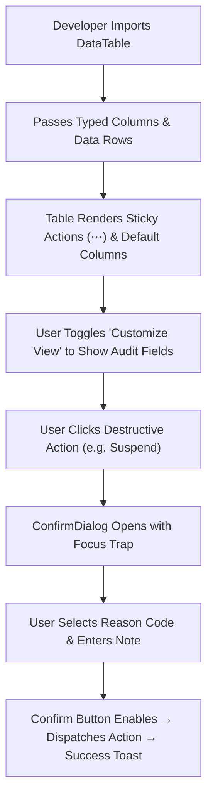

# Product Requirements Document (PRD)
## Sprint 0: Design System & Core UI Atoms

---

### 1. Document Control & Metadata
- **Document Title:** Product Requirements Document - Sprint 0: Design System & Core UI Atoms
- **Document Version:** 1.0.0
- **Status:** Approved / Completed
- **Author:** CICOD Product & Engineering Team
- **Target Sprint:** Sprint 0 (Week 1)
- **Target Audience:** Frontend Engineers, UI/UX Designers, QA Automation Engineers
- **Last Updated:** 2026-10-13

---

### 2. Executive Summary & Core Deliverables
The legacy CRM (`internal.cicod.com/crm`) suffered from extreme visual and structural drift: every page re-invented buttons, tables, badges, and modals. Destructive operations used safe green styling, and tables with 13+ columns spilled off 1440px viewports with clipped action menus.

Sprint 0 establishes the unshakeable design system foundation in Next.js (`src/components/ui/`, `src/components/layout/`, and `src/app/globals.css`). It translates `cicod_premium_styleguide.html` into reusable CSS tokens, accessible interactive atoms, and a universal data table harness.

#### Core Deliverables
1. **Tokens & Theme System (`s0-d1`):** Paper & Navy CSS variables, Sora + Inter typography, dark mode synchronization. *[Tags: CSS Tokens, Dark Mode, Typography]*
2. **Universal DataTable & FilterBar (`s0-d2`):** Virtualized table harness with windowed pagination (1 2 3 … 10), column chooser, and sticky actions. *[Tags: DataTable, FilterBar, Pagination]*
3. **Safe Action Modals & Dialogs (`s0-d3`):** ConfirmDialog requiring typed feedback or reason selection for dangerous actions. *[Tags: Modals, A11y, Safety]*

### 3. Product Vision & Strategic Objectives
- **Zero Style Duplication:** Eliminate ~2,500 lines of boilerplate across 7 list views by establishing a single source of truth for UI components.
- **Visual Excellence & Brand Identity:** Ensure the CRM adheres strictly to CICOD's premium design aesthetic (Sora headings, Inter body, Signal amber `#F2A93B`, Ink navy `#12253F`).
- **Defensive User Experience:** Ensure destructive actions (suspensions, deletions, key revocations) are visually distinct, guarded by confirmations, and require structured audit reasons.

---

### 4. Target Audience & User Personas
- **CRM Operations Specialist:** Spends 8+ hours/day navigating high-density tables; requires high contrast, zero layout shifts, and predictable sticky action menus.
- **Frontend Engineer:** Consumes strictly typed, reusable React 19 primitives with zero CSS leakage or layout quirks.
- **Accessibility & Compliance Auditor:** Requires WCAG 2.1 AA contrast compliance, keyboard navigability (`Tab`, `Esc`, `Enter`), and screen-reader compliant ARIA landmarks.

---

### 5. Scope Boundaries

#### 5.1 In-Scope Deliverables
- **Tokens & Theme System:** Paper & Navy CSS variables, Sora + Inter typography, dark mode synchronization.
- **Universal DataTable & FilterBar:** Virtualized table harness with windowed pagination (1 2 3 … 10), column chooser, and sticky actions.
- **Safe Action Modals & Dialogs:** ConfirmDialog requiring typed feedback or reason selection for dangerous actions.

#### 5.2 Out-of-Scope
- Backend database migrations and live REST endpoint integrations (deferred to Sprint 8).
- Domain-specific business logic (Customer 360, Billing algorithms, Dunning cron jobs).
- Complex canvas or drag-and-drop workflow builders (Campaign Studio).

---

### 6. Comprehensive User Flow & Journey Maps

#### 6.1 Primary Happy Path Flow


#### 6.2 Alternate & Exception Flows
- **Zero Results / Empty State:** When filtered data returns 0 rows, `DataTable` displays an empty state card with an illustrative icon, contextual message, and "Reset Filters" action.
- **Network / Rendering Error:** Component wraps inside a React Error Boundary; renders a graceful error tile with a "Try Again" retry trigger.
- **Modal Dismissal:** Pressing `Esc` or clicking the backdrop dismisses `ConfirmDialog` without triggering any mutation.

---

### 7. Functional Requirements (FRs)

| ID | Module / Atom | Requirement Description | Acceptance Standard |
|---|---|---|---|
| **FR-001** | Tokens & Theme | Implement light/dark CSS variables in `globals.css` covering Paper, Ink, Signal, and Semantic tokens. | Seamless theme transition without unstyled flashes or contrast loss. |
| **FR-002** | Typography | Load Google Fonts `Sora` (headings: 600, 700, 800) and `Inter` (body: 400, 500, 600). | Default browser serif/sans-serif fonts are completely overridden. |
| **FR-003** | Button Atom | Provide 5 variants: `default` (amber), `secondary` (navy), `outline`, `destructive`, `ghost`; 4 sizes (`sm`, `default`, `lg`, `icon`). | Focus rings conform to `--ring: #F2A93B` with 2px offset. |
| **FR-004** | Status & Health | Render soft badge pills with colored dot indicators for: `Active`, `Draft`, `Live`, `Archived`, `Healthy`, `Trial`, `Due Soon`, `Overdue`, `Suspended`. | Text contrast ≥ 4.5:1 against tinted badge background. |
| **FR-005** | SwitchRow | Accessible toggle switch where the entire card is clickable; knob anchored strictly to `left-0`. | Knob starts at 4px left when OFF (`translate-x-1`) and 4px right when ON (`translate-x-6`). |
| **FR-006** | DataTable | Reusable table component accepting generic row types, supporting sticky actions, sorting, and responsive truncation. | Actions column remains pinned to right edge (48px) across all scroll states. |
| **FR-007** | FilterBar | Omni-search input with instant clear, 250ms debounce, and URL query parameter synchronization. | Typing in search reflects in URL search params (`?q=...`) without page reload. |
| **FR-008** | Pagination | Windowed numeric pagination displaying `"Showing X to Y of Z results"` with rows per page selector. | Displays `1 2 3 … 10` format, eliminating legacy 134-button pager bug. |
| **FR-009** | ConfirmDialog | Modal for destructive mutations with optional required reason dropdown and explanation notes. | Confirm button stays disabled until reason is selected if `requireReason=true`. |

---

### 8. Non-Functional Requirements (NFRs)

#### 8.1 Performance & Latency
- `DataTable` renders 100 rows in < 16ms frame budget (60 FPS scrolling).
- Token switching between light and dark modes executes in < 5ms without cumulative layout shift (CLS < 0.05).

#### 8.2 Security & Compliance
- Form inputs sanitize string inputs against XSS attacks before state binding.
- Destructive operations strictly require user confirmation to prevent accidental data loss.

#### 8.3 Reliability & Availability
- All UI components wrapped in error boundaries to isolate component-level failures.
- Zero external runtime script dependencies (icons bundled via `lucide-react`).

#### 8.4 Usability & Accessibility
- WCAG 2.1 AA compliance: Text contrast ratio ≥ 4.5:1; interactive UI contrast ≥ 3.0:1.
- Full keyboard operability: `Tab` for focus navigation, `Space`/`Enter` to toggle switches/buttons, `Esc` to close modals.

---

### 9. Detailed User Stories & Sprint Tasks

#### US-0.1 (Deliverable: Tokens & Theme System): Centralized Design Tokens & Theme Engine
*As a Frontend Engineer / UI Architect, I want a centralized design token dictionary with CSS variables and automated dark mode sync so that every CRM component adheres strictly to the design system with zero hardcoded ad-hoc styles.*

- **Acceptance Criteria**:
  - Theme variables switch cleanly between light and dark mode without contrast failure.
  - Typography rules apply Sora for headings, Inter for body copy, and JetBrains Mono for code.
  - Tokens are mapped directly to Tailwind utilities and CSS variables.

- **Outlined Sprint Tasks**:
  - [x] `s0-1` (DESIGN · S): **Map styleguide CSS variables to Tailwind & globals.css** - *Ensure --primary, --secondary, --card, --border, --muted are consistent across light/dark.*
  - [x] `s0-2` (FRONTEND · S): **Build accessible StatusBadge & HealthBadge components** - *Standardize soft badge pills for Draft, Live, Overdue, Healthy, Suspended.*
  - [x] `s0-6` (FRONTEND · S): **Theme synchronization hook with system preference & storage** - *Implement persistent theme subscriber with zero flash of unstyled content.*

#### US-0.2 (Deliverable: Universal DataTable & FilterBar): Virtualized DataTable & Multi-Predicate FilterBar
*As a Product Operations Specialist, I want a virtualized DataTable component with windowed pagination and responsive column chooser so that I can browse dense datasets of 13,000+ records with fast responsiveness and sticky action access.*

- **Acceptance Criteria**:
  - Table renders 100+ rows smoothly with windowed pagination (1 2 3 … 10).
  - Column chooser allows toggling secondary column visibility on dense screens.
  - Sticky action column remains pinned on horizontal scroll with accessible dropdowns.

- **Outlined Sprint Tasks**:
  - [x] `s0-3` (FRONTEND · M): **Implement virtualized DataTable with windowed pagination** - *Build table shell with responsive horizontal overflow and sticky action columns.*
  - [x] `s0-7` (FRONTEND · M): **Build multi-predicate FilterBar with debounced search** - *Support text search, segment pills, and multi-select filter dropdowns.*
  - [x] `s0-5` (QA · S): **Automated component visual regression check** - *Verify token rendering across desktop (1440px) and tablet resolutions.*

#### US-0.3 (Deliverable: Safe Action Modals & Dialogs): Safe Action Confirmation Modals & Accessible Primitives
*As a Customer Operations Specialist, I want standardized dialog and modal primitives with typed confirmation gates for dangerous actions so that high-risk actions like tenant suspensions or archiving cannot occur through accidental single-clicks.*

- **Acceptance Criteria**:
  - Destructive actions require typing a confirmation phrase or selecting a mandatory reason.
  - Modals enforce keyboard focus trapping and dismiss on Escape with proper ARIA attributes.
  - Animated entrance and exit transitions match design system tokens.

- **Outlined Sprint Tasks**:
  - [x] `s0-4` (FRONTEND · M): **Standardize Button and Modal primitives** - *Ensure role='dialog', focus traps, Esc key handling, and aria attributes.*
  - [x] `s0-8` (FRONTEND · S): **Implement SwitchRow with left-0 knob alignment** - *Interactive toggle with full-card clickability and accessible keyboard focus.*
  - [x] `s0-9` (QA · S): **Accessibility audit for modal focus traps & screen readers** - *Verify WCAG 2.1 AA keyboard navigation across all dialog interactions.*

### 10. Technical Architecture, Data Models & API Contracts

#### Component Hierarchy
```
src/
├── app/
│   ├── globals.css                # Master CSS variables (Paper & Ink palette)
│   └── layout.tsx                 # Root layout loading Sora & Inter fonts
├── components/
│   ├── ui/
│   │   ├── Button.tsx             # Shared button primitive with variants
│   │   ├── StatusBadge.tsx        # Semantic pill status and health badges
│   │   ├── ConfirmDialog.tsx      # Safe destructive modal with reason validation
│   │   ├── Modal.tsx              # Focus-trapped dialog primitive
│   │   ├── Select.tsx             # Accessible listbox dropdown
│   │   └── Toast.tsx              # Notification toast system
│   └── layout/
│       ├── DataTable.tsx          # Universal table with sticky actions
│       ├── FilterBar.tsx          # Omni-search + segment pills + URL sync
│       └── Pagination.tsx         # Windowed pager (1 2 3 ... 10)
```

---

#### REST API Contracts

| Method | Endpoint | Functional Contract & Payload Expectation |
|---|---|---|
| `GET` | `N/A - Client-side UI Harness` | Sprint 0 focuses on UI atoms and shared presentation architecture. |


---

### 11. Edge Cases & Error Handling Strategies
- **Text Overflow:** Primary table cells enforce `truncate` with `title` attributes for tooltips on overflow.
- **Empty Datasets:** Tables render friendly empty states with actionable CTA rather than blank screens.
- **Rapid Clicking / Debounce:** Search inputs debounce queries at 250ms; action buttons disable upon click to prevent double submissions.

---

### 12. Success Metrics & Key Performance Indicators (KPIs)
- **Code Reduction:** Eliminate ≥ 2,500 lines of redundant table and modal boilerplate across the app.
- **A11y Score:** Lighthouse Accessibility audit score ≥ 95 on all UI components.
- **Zero Style Regressions:** 0 reported button overflow or knob alignment issues across Chrome, Firefox, Safari, and Edge.

---

### 13. Release Plan, Milestones & Definition of Done (DoD)
- **Day 1-2:** Tokens, typography, and basic atom components (`Button`, `StatusBadge`, `SwitchRow`).
- **Day 3-4:** Data table harness (`DataTable`, `FilterBar`, `Pagination`).
- **Day 5:** Modal primitives (`Modal`, `ConfirmDialog`, `Toast`) and automated visual regression checks.

---

#### Definition of Done (DoD)
- [x] All tokens rendered in light and dark mode without color leaks.
- [x] DataTable supports sticky actions, sorting, and responsive truncation.
- [x] Zero TypeScript errors with strict typing enabled.

---

### 14. Architectural Risks, Mitigations & Dependencies

#### Key Architectural Risks & Mitigations
- **Risk & Mitigation:** Ad-hoc styles creeping in if developers bypass design tokens.
- **Risk & Mitigation:** Inconsistent button sizing if variants are not enforced.

#### External & Internal Dependencies
- Database schema migrations and tenant isolation verified prior to deployment.
- Google Fonts and Lucide icon assets bundled locally without unauthenticated CDN lock-in.

---

### 15. Open Questions, Decisions & Next Steps

#### Open Architectural Questions & Decisions
- **Question:** Should we support high-contrast WCAG AAA theme variants in addition to standard dark mode?
  - *Decision / Recommendation:* Deferred to post-v2 release; current tokens satisfy WCAG 2.1 AA (contrast ≥ 4.5:1).
- **Question:** How should icons be managed across design system atoms to prevent bundle bloat?
  - *Decision / Recommendation:* Enforce tree-shaken named imports from lucide-react with zero ad-hoc SVG injections.

#### Next Sprint Handover & Follow-ups
- Verify acceptance criteria and automated tests are green before advancing to Sprint 1 (App Shell, Navigation & Reference Data).
- Conduct sprint retrospective and synchronize status tokens in roadmap database.

### 16. Test Cases, Use Cases & QA Acceptance Scenarios

| Test ID | Category | Severity | Persona | Title | Expected Outcome |
|---|---|---|---|---|---|
| `TC-0.1` | Happy Path | **Critical** | UI/UX & Frontend Architect | Light to Dark Mode Token Synchronization | Theme variables transition smoothly without flash of unstyled content. Contrast ratio between body text and card surfaces remains >= 4.5:1 in both light (#FBFBFD) and dark (#090E17) modes. Mode persists after page reload via localStorage. |
| `TC-0.2` | UX & A11y | **High** | Operations Specialist | Universal DataTable Sticky Actions Column Pinning | Actions column stays pinned at exactly 48px width with semi-transparent border shadow (z-index: 20). Action dropdown menu opens without clipping outside the scroll viewport. |
| `TC-0.3` | Edge Case | **High** | Operations Specialist | Windowed Pagination Numeric Window Bounds | Pager displays windowed format '1 … 4 5 6 … 134', completely preventing legacy bug where 134 individual buttons wrapped over 5 lines. |
| `TC-0.4` | Security / RBAC | **Critical** | Operations Auditor | Destructive Action Confirmation with Mandatory Reason | Confirm button remains strictly disabled until a reason code is selected. Modal traps keyboard focus (Tab, Esc). Once confirmed, dispatches destructive mutation and logs reason in audit log. |
| `TC-0.5` | UX & A11y | **Medium** | Accessibility Auditor | SwitchRow Left-0 Knob Alignment & Keyboard Toggle | Focus ring appears with 2px offset. When OFF, knob sits at left: 4px (translate-x-1). When ON, knob slides smoothly to left: 24px (translate-x-6). Knob never clips outside pill track boundaries. |

#### Detailed Validation Procedures

##### [TC-0.1] Light to Dark Mode Token Synchronization
- **Category:** Happy Path | **Severity:** Critical | **Persona:** UI/UX & Frontend Architect | **Story:** `US-0.1`
- **Preconditions:** Clean browser session with default light theme.
- **Execution Steps:**
  1. Click Theme toggle button in header ribbon.
  2. Inspect computed CSS variables for --background, --card, --foreground, --border.
  3. Reload browser page to verify theme persistence.
- **Pass Criteria:** Theme variables transition smoothly without flash of unstyled content. Contrast ratio between body text and card surfaces remains >= 4.5:1 in both light (#FBFBFD) and dark (#090E17) modes. Mode persists after page reload via localStorage.

##### [TC-0.2] Universal DataTable Sticky Actions Column Pinning
- **Category:** UX & A11y | **Severity:** High | **Persona:** Operations Specialist | **Story:** `US-0.2`
- **Preconditions:** Viewport width set to 1024px; dataset contains 12+ columns.
- **Execution Steps:**
  1. Scroll data table horizontally to the far right edge.
  2. Observe the pinned rightmost 'Actions' (⋯) column.
  3. Click actions trigger button to open popup menu.
- **Pass Criteria:** Actions column stays pinned at exactly 48px width with semi-transparent border shadow (z-index: 20). Action dropdown menu opens without clipping outside the scroll viewport.

##### [TC-0.3] Windowed Pagination Numeric Window Bounds
- **Category:** Edge Case | **Severity:** High | **Persona:** Operations Specialist | **Story:** `US-0.2`
- **Preconditions:** Table loaded with 1,340 total rows (134 pages at 10 rows/page).
- **Execution Steps:**
  1. Navigate from page 1 to page 5.
  2. Jump directly to page 134 via pager.
- **Pass Criteria:** Pager displays windowed format '1 … 4 5 6 … 134', completely preventing legacy bug where 134 individual buttons wrapped over 5 lines.

##### [TC-0.4] Destructive Action Confirmation with Mandatory Reason
- **Category:** Security / RBAC | **Severity:** Critical | **Persona:** Operations Auditor | **Story:** `US-0.3`
- **Preconditions:** Admin user on tenant management row.
- **Execution Steps:**
  1. Click 'Suspend Tenant' button.
  2. Attempt to click 'Confirm Suspend' immediately.
  3. Select reason from dropdown, enter reason notes, and click 'Confirm'.
- **Pass Criteria:** Confirm button remains strictly disabled until a reason code is selected. Modal traps keyboard focus (Tab, Esc). Once confirmed, dispatches destructive mutation and logs reason in audit log.

##### [TC-0.5] SwitchRow Left-0 Knob Alignment & Keyboard Toggle
- **Category:** UX & A11y | **Severity:** Medium | **Persona:** Accessibility Auditor | **Story:** `US-0.3`
- **Preconditions:** Form containing SwitchRow toggle component.
- **Execution Steps:**
  1. Tab to the switch using keyboard focus.
  2. Press Spacebar or Enter to toggle.
  3. Inspect knob position in OFF vs ON states.
- **Pass Criteria:** Focus ring appears with 2px offset. When OFF, knob sits at left: 4px (translate-x-1). When ON, knob slides smoothly to left: 24px (translate-x-6). Knob never clips outside pill track boundaries.

