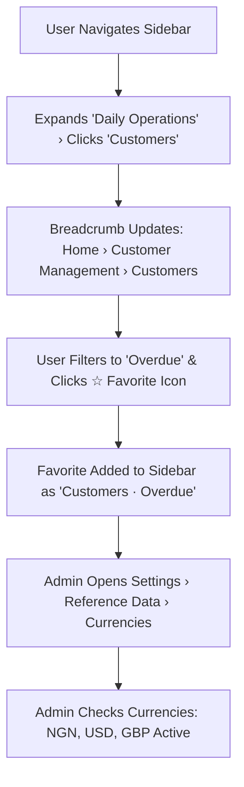

# Product Requirements Document (PRD)
## Sprint 1: App Shell, Navigation & Reference Data

---

### 1. Document Control & Metadata
- **Document Title:** Product Requirements Document - Sprint 1: App Shell, Navigation & Reference Data
- **Document Version:** 1.0.0
- **Status:** In Progress
- **Author:** CICOD Product & Architecture Team
- **Target Sprint:** Sprint 1 (Week 2)
- **Target Audience:** Frontend Engineers, Backend Architects, Operations Leads, System Administrators
- **Last Updated:** 2026-10-13

---

### 2. Executive Summary & Core Deliverables
The legacy CRM navigation contained 8 arbitrary top-level sections, including top-level menu entries for 1-record tables (`Product Types`) and 4-record reference lists (`Service Types`). Breadcrumbs were hard-coded to "Home › Customer Mgt › Customers" across all pages, and 8 separate Business Setup pages held uncurated lists of 119 currencies and 251 countries.

Sprint 1 delivers a clean two-level application shell with a collapsible sidebar (260px → 72px), route-computed dynamic breadcrumbs, a user favorites bar, and a centralized Reference Data hub under Settings.

#### Core Deliverables
1. **Dual/Collapsible App Sidebar (`s1-d1`):** Grouped by job: Daily Operations, Growth, Administration. Collapses from 260px to 72px. *[Tags: Sidebar, IA, Navigation]*
2. **Dynamic Breadcrumbs & Header (`s1-d2`):** Path-computed navigation with active entity titles and Quick Search. *[Tags: Header, Breadcrumbs, Favorites]*
3. **Unified Reference Data Module (`s1-d3`):** Single screen for Currencies (NGN, USD, GBP), Operating Locations (Country/State/LGA), and Sectors. *[Tags: Reference Data, Currencies, Locations]*

### 3. Product Vision & Strategic Objectives
- **Information Architecture Discipline:** Enforce a strict "two levels at most" rule; reference lists move to Settings.
- **Contextual Awareness:** Ensure every screen shows users exactly where they sit via live breadcrumbs.
- **Data Integrity & Protection:** Prevent operational errors by enforcing guard rails (e.g. currencies in active use cannot be disabled).

---

### 4. Target Audience & User Personas
- **System Administrator:** Curates trading currencies, operating locations, and business sectors across the tenant base.
- **Support & Operations Specialist:** Jumps rapidly between customer profiles and billing queues via bookmarked favorites.
- **Product Manager:** Needs certainty that changing reference data safely cascades to pricing and onboarding forms.

---

### 5. Scope Boundaries

#### 5.1 In-Scope Deliverables
- **Dual/Collapsible App Sidebar:** Grouped by job: Daily Operations, Growth, Administration. Collapses from 260px to 72px.
- **Dynamic Breadcrumbs & Header:** Path-computed navigation with active entity titles and Quick Search.
- **Unified Reference Data Module:** Single screen for Currencies (NGN, USD, GBP), Operating Locations (Country/State/LGA), and Sectors.

#### 5.2 Out-of-Scope
- External multi-tenant organization switching (single-org CRM focus).
- Live third-party currency exchange rate feed integrations (manual curation for trading stability).
- End-user customer portal navigation (internal staff console focus).

---

### 6. Comprehensive User Flow & Journey Maps

#### 6.1 Primary Happy Path Flow


#### 6.2 Alternate & Exception Flows
- **Attempting to Deactivate In-Use Currency:** User tries to switch off `NGN`; system checks active plan count, blocks toggle, and displays a warning toast ("NGN is used by 14 active plans and cannot be switched off").
- **Deep Entity Route Match:** When navigating to `/customers/23488`, breadcrumb resolves entity name to display `Home > Customer Management > Customers > crmdemo (#23488)`.
- **Collapsed Sidebar Usage:** User collapses sidebar to 72px; hover tooltips display full submenu items for immediate access.

---

### 7. Functional Requirements (FRs)

| ID | Module | Requirement Description | Acceptance Standard |
|---|---|---|---|
| **FR-101** | App Shell | Sidebar with 2 levels max; collapses from 260px to 72px with floating hover submenus. | Collapse state persists in localStorage; smooth transition. |
| **FR-102** | Breadcrumbs | Dynamic breadcrumbs derived from active route matching against `nav.ts` hierarchy. | Detail routes render entity name instead of raw token. |
| **FR-103** | Favorites | Header star icon toggles active page/filters into sidebar Favorites list. | Starred items open with preserved URL query parameters. |
| **FR-104** | Currencies | Curate trading currencies (NGN, USD, GBP, EUR) with active switches. | Currencies used by live plans cannot be switched off. |
| **FR-105** | Locations | Hierarchical Country → State → LGA management with completeness indicators. | Only operational countries enabled; LGAs drill down in place. |
| **FR-106** | Sectors & Types | Parent Sector to child Business Types mapping with inline creation. | Sectors with active tenants cannot be deleted or disabled. |
| **FR-107** | Payment Channels | Configure online (Card) vs. offline methods (Bank Transfer, Cash) and reference requirements. | Offline methods configure whether bank reference is mandatory. |
| **FR-108** | Catalogue Setup | Relocate Service Types, Product Types, and Bundle Groups under Settings. | Removed from primary root sidebar; accessible under Settings. |

---

### 8. Non-Functional Requirements (NFRs)

#### 8.1 Performance & Latency
- Sidebar route transitions complete in < 50ms using Next.js Link prefetching.
- Reference data lists load in < 150ms without layout jump.

#### 8.2 Security & Compliance
- Reference data modifications restricted to staff with Administrator role privileges.
- All reference changes logged to the immutable system audit log.

#### 8.3 Reliability & Availability
- Navigation tree state remains resilient during deep linking and browser refresh.
- 99.9% availability of client-side routing.

#### 8.4 Usability & Accessibility
- WCAG 2.1 AA keyboard navigation: Tab focus through sidebar links; Esc closes expanded flyouts.
- High-contrast active link indicator (`bg-[var(--accent)] text-[var(--primary)]`).

---

### 9. Detailed User Stories & Sprint Tasks

#### US-1.1 (Deliverable: Dual/Collapsible App Sidebar): Collapsible App Sidebar Navigation
*As a CRM Daily User, I want a clean 2-level collapsible sidebar navigation grouped by Daily Operations, Growth, and Administration so that I can switch modules quickly without getting lost in legacy 8-tier nested submenus.*

- **Acceptance Criteria**:
  - Sidebar collapses from 260px expanded to 72px icon rail with active badge tooltips.
  - Active group and leaf routes automatically highlight based on URL pathname.
  - Favorites section pins frequently accessed pages for 1-click access.

- **Outlined Sprint Tasks**:
  - [x] `s1-2` (FRONTEND · M): **Build Favorites manager with localStorage persistence** - *Allow starring any filtered list view or quick action into the sidebar.*
  - [x] `s1-6` (FRONTEND · M): **Implement collapsible sidebar rail with smooth width transition** - *Animated collapse/expand with responsive 72px/260px margins.*
  - [x] `s1-7` (QA · S): **Audit mobile drawer behavior and viewport responsiveness** - *Verify mobile sidebar drawer overlay, focus traps, and touch targets.*

#### US-1.2 (Deliverable: Dynamic Breadcrumbs & Header): Dynamic Breadcrumbs & Contextual Header
*As a Account Support Agent, I want a path-computed dynamic breadcrumb bar displaying actual customer or plan names instead of static labels so that I always know my exact location within deeply nested customer and catalogue hierarchies.*

- **Acceptance Criteria**:
  - Breadcrumb dynamically resolves entity names from active route params.
  - Clicking any parent crumb navigates back with preserved filter state.
  - Header includes quick theme switcher, favorites star, and Roadmap link.

- **Outlined Sprint Tasks**:
  - [x] `s1-1` (FRONTEND · M): **Implement dynamic breadcrumbs in Header.tsx** - *Build breadcrumb hierarchy from route matchers instead of hard-coded strings.*
  - [x] `s1-8` (FRONTEND · S): **Add entity name resolver for customer, plan, and lead IDs** - *Resolve actual company and plan names in breadcrumb trail dynamically.*
  - [x] `s1-9` (QA · S): **Automated navigation path test suite covering all 25 routes** - *Test active leaf matching and breadcrumb hierarchy across deep paths.*

#### US-1.3 (Deliverable: Unified Reference Data Module): Consolidated Reference Data Workspace
*As a System Administrator, I want a consolidated Reference Data workspace to configure active currencies, operating locations, and business sectors so that I can curate core platform reference entities in one central hub instead of 8 fragmented legacy pages.*

- **Acceptance Criteria**:
  - Currencies view allows toggling active trading currencies (NGN, USD, GBP, KES, GHS).
  - Operating locations tree supports Country → State → LGA drilldown.
  - Reference data changes propagate immediately to plan editors and merchant forms.

- **Outlined Sprint Tasks**:
  - [x] `s1-3` (FRONTEND · L): **Consolidate 8 Business Setup pages into ReferenceView** - *Tabbed interface for Currencies, Locations, Business Types, and Payment Channels.*
  - [x] `s1-4` (FRONTEND · S): **Move Service Types & Product Types under Settings** - *Relocate low-volume catalogue reference data out of primary navigation.*
  - [ ] `s1-5` (BACKEND · M): **Define Reference Data API Contract** - *Implement endpoints for full list retrieval without legacy 100-record truncation.*

### 10. Technical Architecture, Data Models & API Contracts

#### Navigation Configuration (`src/lib/nav.ts`)
```typescript
export type NavLeaf = { label: string; href: string };
export type NavFolder = { label: string; children: NavLeaf[] };
export type NavGroup = { title: string; icon: ElementType; href?: string; children?: (NavLeaf | NavFolder)[] };
export type NavSection = { caption: string; groups: NavGroup[] };

export const NAV: NavSection[];
export function matchNav(pathname: string): NavMatch | undefined;
```

#### Target REST API Contracts
- `GET /api/v2/reference/currencies`: Returns list of currencies with plan usage counts.
- `PATCH /api/v2/reference/currencies/{code}`: Toggles currency active state.
- `GET /api/v2/reference/locations`: Returns country/state/LGA hierarchy.
- `GET /api/v2/reference/sectors`: Returns sectors with nested business types.
- `PATCH /api/v2/reference/payment-methods/{id}`: Toggles payment method rules.

---

#### REST API Contracts

| Method | Endpoint | Functional Contract & Payload Expectation |
|---|---|---|
| `GET` | `/api/v2/reference/currencies` | Returns active trading currencies with usage flags. |
| `GET` | `/api/v2/reference/locations` | Hierarchical Country → State → LGA operational tree. |
| `GET` | `/api/v2/reference/sectors` | Business sectors with child business types. |
| `PATCH` | `/api/v2/reference/payment-methods` | Toggles offline method availability and reference requirements. |


---

### 11. Edge Cases & Error Handling Strategies
- **Deeply Nested Locations:** Lazy-load state and LGA lists on demand to prevent heavy initial payload.
- **Special Characters in Types:** Sanitize business type inputs to prevent HTML tag injection.
- **Storage Quota Exceeded:** Gracefully cap saved favorites at 20 items per user.

---

### 12. Success Metrics & Key Performance Indicators (KPIs)
- **Navigation Efficiency:** Average clicks to reach customer records reduced from 4 clicks to 1-2 clicks.
- **Reference Integrity:** 0 broken plan assignments due to disabled currencies or deleted sectors.
- **Sidebar Adoption:** ≥ 80% of daily active staff utilize at least 1 saved Favorite shortcut.

---

### 13. Release Plan, Milestones & Definition of Done (DoD)
- **Milestone 1.1:** Navigation structure refactor (`nav.ts`) and dynamic breadcrumbs.
- **Milestone 1.2:** Favorites manager with local storage engine.
- **Milestone 1.3:** Reference Data hub with Currencies, Locations, and Sectors tabs.
- **Milestone 1.4:** Move Service Types, Product Types, and Bundle Groups to Settings.

---

#### Definition of Done (DoD)
- [ ] Breadcrumb reflects exact path hierarchy on all nested views.
- [ ] Deactivating a currency in Reference Data immediately removes it from plan editors.
- [ ] Reference lists load complete records without legacy 100-item cutoff.

---

### 14. Architectural Risks, Mitigations & Dependencies

#### Key Architectural Risks & Mitigations
- **Risk & Mitigation:** Deleting or switching off a sector that is actively used by existing merchants.
- **Risk & Mitigation:** Slow location hierarchy queries if regions are deeply nested.

#### External & Internal Dependencies
- Database schema migrations and tenant isolation verified prior to deployment.
- Google Fonts and Lucide icon assets bundled locally without unauthenticated CDN lock-in.

---

### 15. Open Questions, Decisions & Next Steps

#### Open Architectural Questions & Decisions
- **Question:** Should user favorites synchronize to backend database or remain local to browser?
  - *Decision / Recommendation:* Initial release leverages localStorage for sub-millisecond response; cloud user sync scheduled for v2.1.
- **Question:** How deep should dynamic breadcrumbs resolve live database entity names?
  - *Decision / Recommendation:* Maximum 3 levels of dynamic resolution (Module › Section › Entity Name) with local cache fallback.

#### Next Sprint Handover & Follow-ups
- Verify acceptance criteria and automated tests are green before advancing to Sprint 2 (Commercial Catalogue & Pricing Matrix).
- Conduct sprint retrospective and synchronize status tokens in roadmap database.

### 16. Test Cases, Use Cases & QA Acceptance Scenarios

| Test ID | Category | Severity | Persona | Title | Expected Outcome |
|---|---|---|---|---|---|
| `TC-1.1` | Happy Path | **Critical** | Daily CRM Operator | Two-Level Collapsible Sidebar Responsive Rail | Sidebar width animates smoothly from 260px to 72px. Main content margin adjusts from ml-[260px] to ml-[72px] without layout shift. Floating flyout menu appears on hover with active item highlight. |
| `TC-1.2` | Happy Path | **High** | Support Agent | Dynamic Route Breadcrumb Entity Name Resolution | Breadcrumb displays 'Home > Customer Management > Customers > Acme Logistics Ltd (#23488)' rather than raw token. Clicking parent crumb returns to customer list with preserved filter state. |
| `TC-1.3` | Edge Case | **Critical** | System Administrator | Guarded Reference Data Deletion for Active Currencies | System detects activePlanCount > 0, blocks toggle mutation, and displays error toast: 'NGN is used by 14 active plans and cannot be deactivated'. |
| `TC-1.4` | Happy Path | **Medium** | Daily CRM Operator | User Favorites Starring & LocalStorage Persistence | Favorite is saved to sidebar as 'Customers · Overdue Enterprise'. Clicking it loads the exact filtered dataset with query params intact. State survives browser restart. |

#### Detailed Validation Procedures

##### [TC-1.1] Two-Level Collapsible Sidebar Responsive Rail
- **Category:** Happy Path | **Severity:** Critical | **Persona:** Daily CRM Operator | **Story:** `US-1.1`
- **Preconditions:** Desktop viewport (1440px).
- **Execution Steps:**
  1. Click sidebar toggle button to collapse.
  2. Hover over collapsed module icons.
  3. Click sub-item from flyout.
- **Pass Criteria:** Sidebar width animates smoothly from 260px to 72px. Main content margin adjusts from ml-[260px] to ml-[72px] without layout shift. Floating flyout menu appears on hover with active item highlight.

##### [TC-1.2] Dynamic Route Breadcrumb Entity Name Resolution
- **Category:** Happy Path | **Severity:** High | **Persona:** Support Agent | **Story:** `US-1.2`
- **Preconditions:** Customer record #23488 exists with name 'Acme Logistics Ltd'.
- **Execution Steps:**
  1. Navigate to /crm/customers/23488.
  2. Inspect breadcrumb trail in header.
  3. Click 'Customers' parent crumb.
- **Pass Criteria:** Breadcrumb displays 'Home > Customer Management > Customers > Acme Logistics Ltd (#23488)' rather than raw token. Clicking parent crumb returns to customer list with preserved filter state.

##### [TC-1.3] Guarded Reference Data Deletion for Active Currencies
- **Category:** Edge Case | **Severity:** Critical | **Persona:** System Administrator | **Story:** `US-1.3`
- **Preconditions:** Currency NGN assigned to 14 active subscription plans.
- **Execution Steps:**
  1. Open /crm/settings/reference.
  2. Click 'Currencies' tab.
  3. Attempt to toggle OFF currency NGN.
- **Pass Criteria:** System detects activePlanCount > 0, blocks toggle mutation, and displays error toast: 'NGN is used by 14 active plans and cannot be deactivated'.

##### [TC-1.4] User Favorites Starring & LocalStorage Persistence
- **Category:** Happy Path | **Severity:** Medium | **Persona:** Daily CRM Operator | **Story:** `US-1.1`
- **Preconditions:** Customer list filtered by status=overdue&tier=enterprise.
- **Execution Steps:**
  1. Click star icon in header.
  2. Verify sidebar Favorites group.
  3. Refresh browser page and click the favorite link.
- **Pass Criteria:** Favorite is saved to sidebar as 'Customers · Overdue Enterprise'. Clicking it loads the exact filtered dataset with query params intact. State survives browser restart.

