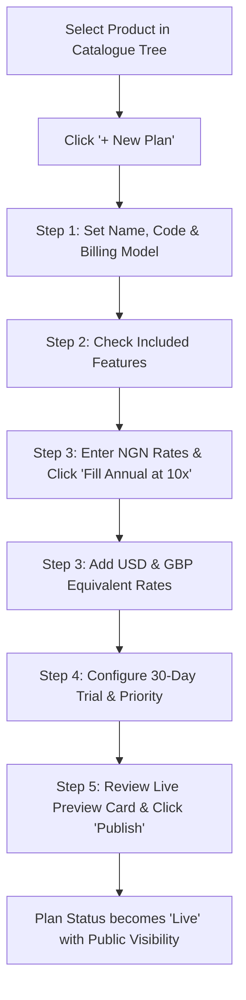

# Product Requirements Document (PRD)
## Sprint 2: Commercial Catalogue & Pricing Matrix

---

### 1. Document Control & Metadata
- **Document Title:** Product Requirements Document - Sprint 2: Commercial Catalogue & Pricing Matrix
- **Document Version:** 1.0.0
- **Status:** In Progress
- **Author:** CICOD Product & Architecture Team
- **Target Sprint:** Sprint 2 (Week 3)
- **Target Audience:** Commercial Directors, Product Managers, Billing Ops, Frontend & Backend Engineers
- **Last Updated:** 2026-10-13

---

### 2. Executive Summary & Core Deliverables
The legacy commercial catalogue was fragmented across 7 disjointed tables (`Products`, `Product Captions`, `Bundle Groups`, `Single Offers`, `Bundles`, `Service Types`, `Product Types`). Modals omitted multi-currency pricing, feature checklists, and trial durations. About 25 of 35 single offers were duplicate or obsolete records ("Premium.", "Premium 1", "Standard Test"), and no screen visualized missing currency rates or protected public pricing from accidental one-click deletion.

Sprint 2 unifies the commercial catalogue into a master **Products & Plans Workspace**, a full-page **5-Step Plan Editor**, a **Bundle Editor**, and a **Global Pricing Gap Matrix**, enforcing strict lifecycle governance: `Draft → Live (Published) → Archived`.

#### Core Deliverables
1. **Products & Plans Tree Workspace (`s2-d1`):** Product sidebar on left; comparative plan cards and feature checklist on right. *[Tags: Catalogue, Plans, Features]*
2. **5-Step Plan Editor Stepper (`s2-d2`):** Basics → Features checklist → Multi-currency Pricing matrix → Trial & Extras → Review & Publish. *[Tags: Plan Editor, Pricing Matrix, Stepper]*
3. **Bundle Editor & Savings Engine (`s2-d3`):** Compose multi-product bundles, set seat limits, and calculate customer savings. *[Tags: Bundles, Discounts, Licensing]*

### 3. Product Vision & Strategic Objectives
- **Commercial Single Source of Truth:** Eliminate conflicting duplicate offers and create a coherent commercial definition for every tier.
- **Global Multi-Currency Readiness:** Enable frictionless expansion across NGN, USD, and GBP with transparent parity checks.
- **Revenue Protection:** Prevent breaking public checkouts or customer contracts by locking active plans from deletion.

---

### 4. Target Audience & User Personas
- **Commercial Product Manager:** Configures tiers, bundles, feature gates, and discount structures.
- **Sales Director / Account Executive:** Inspects real-time feature matrices, currencies, and bundle savings when pitching enterprise clients.
- **Billing Operations Lead:** Ensures all plans have configured periodic or usage rates before invoices generate.

---

### 5. Scope Boundaries

#### 5.1 In-Scope Deliverables
- **Products & Plans Tree Workspace:** Product sidebar on left; comparative plan cards and feature checklist on right.
- **5-Step Plan Editor Stepper:** Basics → Features checklist → Multi-currency Pricing matrix → Trial & Extras → Review & Publish.
- **Bundle Editor & Savings Engine:** Compose multi-product bundles, set seat limits, and calculate customer savings.

#### 5.2 Out-of-Scope
- Live real-time FX rate synchronization from external central banks (static merchant curation retained).
- Usage metering ingestion engine (covered in Sprint 4 Billing).
- Customer self-serve checkout payment flow (staff configuration console focus).

---

### 6. Comprehensive User Flow & Journey Maps

#### 6.1 Primary Happy Path Flow


#### 6.2 Alternate & Exception Flows
- **Annual Price Mismatch Warning:** If an admin enters a monthly price in USD ($50) but leaves annual USD empty, an amber badge displays: *"USD annual price missing"*.
- **Blocked Archival Attempt:** Admin attempts to archive the "Standard" plan. System queries customer subscriptions: *"1,204 customers are active on Standard. Cannot archive until customers are migrated."* The action is blocked.
- **Bundle Rule Violation:** In Bundle Editor, user attempts to select two plans from the same product. Interface restricts selection to radio behavior per product row.

---

### 7. Functional Requirements (FRs)

#### 7.1 Products & Plans Workspace
- **FR-2.1.1:** Left pane must display product categories and software products with active plan counts.
- **FR-2.1.2:** Right pane must render comparative plan cards with status badges (`Draft`, `Live`, `Archived`) and pricing summaries.
- **FR-2.1.3:** Feature comparison matrix must allow inline feature creation via "+ Add Feature" without navigating away.
- **FR-2.1.4:** Duplicate/archived legacy plans must be hidden behind a collapsible badge toggle: "Show archived (25)".

#### 7.2 5-Step Plan Editor
- **FR-2.2.1:** The plan editor must be a linkable, full-page route (`/crm/catalogue/plans/[code]`) with top progress tracker.
- **FR-2.2.2:** Step 1 must support Billing Models: `PER_USER` (per-seat), `PER_TRANSACTION` (usage/volume), and `PERIODIC` (fixed subscription).
- **FR-2.2.3:** Step 2 must present all product features as checkboxes with select-all capabilities.
- **FR-2.2.4:** Step 3 must enforce NGN as mandatory base currency. USD and GBP must be optional but validated for interval parity.
- **FR-2.2.5:** "Fill Annual at 10×" button must populate empty annual inputs with `10 * monthlyAmount` for all entered currencies.
- **FR-2.2.6:** Step 4 must offer trial toggle (`trialDays` defaulting to 30), recommended plan badge toggle (max 1 per product), and display sort order.
- **FR-2.2.7:** Step 5 must render an interactive live pricing card that toggles Monthly/Annual view before final submission.

#### 7.3 Bundles Workspace
- **FR-2.3.1:** Must support bundle groups (e.g., "CICOD Supply Chain Suite").
- **FR-2.3.2:** Must enforce selection of at most one live plan per constituent product.
- **FR-2.3.3:** Must dynamically calculate bundle package discount % against the sum of individual standalone plan rates.
- **FR-2.3.4:** Must allow setting license limits (`minUsers`, `maxUsers`) and cloud storage allocations (`storageGb`).

#### 7.4 Global Pricing Gap Matrix
- **FR-2.4.1:** Must present an aggregated matrix table: Product × Plan × Currency × Billing Period.
- **FR-2.4.2:** Filter toggle "Only show rows with pricing gaps" must isolate unpriced combinations.

---

### 8. Non-Functional Requirements (NFRs)

#### 8.1 Performance & Latency
- Live preview card recalculations on Step 5 must render in `< 10ms` during user input.
- Catalogue tree search filter must return matching products and plans in `< 50ms` client-side.

#### 8.2 Security & Compliance
- Role-based permissions: Only users with `ROLE_COMMERCIAL_ADMIN` or `ROLE_SUPERADMIN` can transition plans to `Live` or modify base pricing.
- All pricing changes must log a tamper-proof audit event recording User ID, timestamp, prior rate, and new rate.

#### 8.3 Reliability & Availability
- Pricing values must be stored as integer subunits (kobo / cents) in backend payloads to prevent IEEE 754 floating-point rounding errors.
- Unsaved draft changes in the 5-step editor must persist to `sessionStorage` to prevent data loss on accidental tab refresh.

#### 8.4 Usability & Accessibility
- WCAG AA compliant contrast on all plan comparison matrices and status badges.
- Tab-accessible keyboard navigation through all 5 editor steps.

---

### 9. Detailed User Stories & Sprint Tasks

#### US-2.1 (Deliverable: Products & Plans Tree Workspace): Products & Plans Two-Pane Explorer
*As a Commercial Product Manager, I want a split-pane Products & Plans workspace with product tree on left and comparative plan cards on right so that I can visually evaluate plan feature differences and pricing tiers without toggling screens.*

- **Acceptance Criteria**:
  - Sidebar displays all active software products with live plan counters.
  - Comparative cards show monthly/annual prices, features checklist, and status badges.
  - Search and filter isolates plans by status (Draft, Live, Archived).

- **Outlined Sprint Tasks**:
  - [ ] `s2-1` (FRONTEND · L): **Build Products & Plans explorer view** - *Display active plans side-by-side with feature comparison matrix.*
  - [ ] `s2-6` (FRONTEND · M): **Implement product tree filter sidebar with category badges** - *Sidebar displaying live product categories, tier counts, and status filters.*
  - [ ] `s2-7` (FRONTEND · M): **Comparative plan feature diff visualizer** - *Highlight included and excluded features across Starter, Standard, and Enterprise tiers.*

#### US-2.2 (Deliverable: 5-Step Plan Editor Stepper): Multi-Currency Plan Creation Wizard
*As a Pricing Specialist, I want a structured 5-step wizard to configure plan basics, features, multi-currency matrix, trials, and publishing so that I never publish incomplete plans with missing currency equivalents or unverified terms.*

- **Acceptance Criteria**:
  - 5-step wizard enforces: Basics → Features → Pricing Matrix → Trial/Extras → Review.
  - Pricing matrix supports NGN, USD, GBP, EUR with annual 10x multiplier shortcut.
  - Live preview card updates dynamically as pricing and features are edited.

- **Outlined Sprint Tasks**:
  - [ ] `s2-2` (FRONTEND · M): **Implement Pricing Matrix table with NGN/USD/GBP** - *Include annual pricing autofill helper (10x monthly = 2 months free).*
  - [ ] `s2-3` (FRONTEND · XL): **Build Plan Editor 5-step stepper with live preview card** - *Interactive wizard with real-time public pricing card visualization.*
  - [ ] `s2-5` (BACKEND · M): **Enforce Lifecycle: Draft → Live → Archived** - *Block archiving if active customers or bundles reference the plan.*

#### US-2.3 (Deliverable: Bundle Editor & Savings Engine): Multi-Product Bundle Composer & Savings Engine
*As a Sales Operations Director, I want a Bundle Editor to compose multi-product software packages with custom seat licensing and savings calculations so that we can sell bundled solution packages that clearly show merchant percentage discounts.*

- **Acceptance Criteria**:
  - Allows selecting 1 active plan per included product with seat minimums/maximums.
  - Automatically calculates aggregate individual price vs bundle discounted price.
  - Publishing checks that all component plans are in Live status.

- **Outlined Sprint Tasks**:
  - [ ] `s2-4` (FRONTEND · L): **Implement Bundle Editor with product chips** - *Select 1 live plan per product and define minimum/maximum user licenses.*
  - [ ] `s2-8` (FRONTEND · S): **Build bundle customer savings computation engine** - *Compute bundle discount percentages and display comparative customer ROI badge.*
  - [ ] `s2-9` (BACKEND · M): **Bundle component dependency validator in backend** - *Prevent deletion or unpublishing of plans active inside public bundles.*

### 10. Technical Architecture, Data Models & API Contracts

#### Data Schema (`src/lib/mock/catalogue.ts`)
```typescript
export type BillingModel = "PER_USER" | "PER_TRANSACTION" | "PERIODIC";
export type Currency = "NGN" | "USD" | "GBP";
export type Period = "MONTHLY" | "ANNUALLY";

export interface Price {
  currency: Currency;
  period: Period;
  amount: number; // Stored in minor currency units (kobo/cents)
}

export interface Plan {
  code: string;
  productId: string;
  name: string;
  description: string;
  billingModel: BillingModel;
  prices: Price[];
  features: string[];
  trialDays: number;
  recommended: boolean;
  priority: number;
  status: "Draft" | "Live" | "Archived";
  createdAt: string;
  updatedAt: string;
}

export interface Bundle {
  id: string;
  name: string;
  groupId: string;
  planCodes: string[];
  prices: Price[];
  minUsers?: number;
  maxUsers?: number;
  storageGb?: number;
  status: "Draft" | "Live" | "Archived";
}
```

#### REST API Endpoints
| Method | Endpoint | Description | Status Codes |
|---|---|---|---|
| `GET` | `/api/v2/catalogue/products` | Retrieve product tree with nested plans | `200` |
| `POST` | `/api/v2/catalogue/plans` | Save plan draft or update existing draft | `200`, `400` |
| `POST` | `/api/v2/catalogue/plans/{code}/publish` | Transition plan from Draft to Live | `200`, `422` |
| `POST` | `/api/v2/catalogue/plans/{code}/archive` | Archive plan with active subscription check | `200`, `409` |
| `GET` | `/api/v2/catalogue/bundles` | List all commercial bundles | `200` |
| `POST` | `/api/v2/catalogue/bundles` | Create or update bundle configuration | `200`, `400` |

---

#### REST API Contracts

| Method | Endpoint | Functional Contract & Payload Expectation |
|---|---|---|
| `GET` | `/api/v2/catalogue/products` | List products with plan counts and linked features. |
| `POST` | `/api/v2/catalogue/plans` | Create or update plan draft with multi-currency pricing array. |
| `PATCH` | `/api/v2/catalogue/plans/{code}/publish` | Publish plan to public catalog after gap-check validation. |
| `POST` | `/api/v2/catalogue/bundles` | Create bundle combining selected product plan IDs. |


---

### 11. Edge Cases & Error Handling Strategies
- **Zero-Amount Pricing:** Allowed only if explicitly designated as "Free Tier" with `trialDays: 0` and `billingModel: PERIODIC`.
- **Negative Pricing Input:** Form input sanitizers reject values `< 0` and display inline field errors.
- **Network Interruption During Stepper:** Draft state autosaves to local session storage; user is prompted to resume on reconnection.
- **Concurrent Plan Publication:** Optimistic concurrency control via `version` header prevents overwriting simultaneous pricing edits.

---

### 12. Success Metrics & Key Performance Indicators (KPIs)
- **Catalogue Hygiene:** 100% elimination of uncurated duplicate offers (from 35 legacy records down to clean active tiers).
- **Time to Create New Plan:** Reduced from ~45 minutes across 7 tables to `< 4 minutes` via the 5-step wizard.
- **Zero Pricing Gaps:** 100% of published enterprise plans have complete NGN, USD, and GBP rates.
- **Zero Customer Invoice Errors:** 0 billing incidents caused by incomplete or orphaned plan codes.

---

### 13. Release Plan, Milestones & Definition of Done (DoD)
- **Milestone 2.1 (Days 1–3):** Build two-pane Products & Plans tree workspace and comparative plan cards.
- **Milestone 2.2 (Days 4–6):** Implement 5-Step Plan Editor with multi-currency matrix and live preview card.
- **Milestone 2.3 (Days 7–8):** Implement Bundles Workspace and Global Pricing Gap Matrix.
- **Milestone 2.4 (Days 9–10):** Connect lifecycle guards, archive dependency modal, and verify Playwright integration tests.

---

#### Definition of Done (DoD)
- [ ] A plan cannot be published without at least one primary currency (NGN) price.
- [ ] Publishing or unpublishing confirms with full impact summary (affected bundles/users).
- [ ] Features (Product Captions) are managed directly inside the plan workflow.

---

### 14. Architectural Risks, Mitigations & Dependencies

#### Key Architectural Risks & Mitigations
- **Risk & Mitigation:** Currency rate volatility if rates are hardcoded rather than configured.
- **Risk & Mitigation:** Unpublishing a live plan currently selected in an active marketing campaign.

#### External & Internal Dependencies
- Database schema migrations and tenant isolation verified prior to deployment.
- Google Fonts and Lucide icon assets bundled locally without unauthenticated CDN lock-in.

---

### 15. Open Questions, Decisions & Next Steps

#### Open Architectural Questions & Decisions
- **Question:** How should volume discount tiers handle fractional or non-integer quantities?
  - *Decision / Recommendation:* Quantities are strictly positive integers; fractional billing supported via usage metering in Sprint 4.
- **Question:** Should multi-currency conversion be real-time or fixed commercial rate?
  - *Decision / Recommendation:* Fixed commercial rate per billing cycle configured in Reference Data to prevent checkout volatility.

#### Next Sprint Handover & Follow-ups
- Verify acceptance criteria and automated tests are green before advancing to Sprint 3 (Customer Management & Customer 360).
- Conduct sprint retrospective and synchronize status tokens in roadmap database.

### 16. Test Cases, Use Cases & QA Acceptance Scenarios

| Test ID | Category | Severity | Persona | Title | Expected Outcome |
|---|---|---|---|---|---|
| `TC-2.1` | Happy Path | **Critical** | Billing Manager | Multi-Currency Pricing Matrix Computation | Matrix validates all active currencies. Checkout flows in USD charge exactly $250 without unexpected conversion discrepancies. |
| `TC-2.2` | Edge Case | **High** | Product Manager | Volume Discount Tier Range Validation & Zero Gap Check | Form validation catches the gap: 'Tier 2 start quantity must be 1,001 to prevent uncovered billing quantities'. Save button disabled. |
| `TC-2.3` | Happy Path | **High** | Product Operations Lead | Dynamic Service Dependency Resolver in Bundle Builder | Builder flags dependency conflict: 'Starter plan does not meet prerequisite requirements for Advanced AI Assistant'. |
| `TC-2.4` | Security / RBAC | **Critical** | Billing Administrator | Draft vs Live Plan State Guard on Checkout Enrollment | API returns HTTP 422 Unprocessable Entity: 'Cannot enroll customer into Draft commercial plan. Publish plan to Live before onboarding.' |

#### Detailed Validation Procedures

##### [TC-2.1] Multi-Currency Pricing Matrix Computation
- **Category:** Happy Path | **Severity:** Critical | **Persona:** Billing Manager | **Story:** `US-2.2`
- **Preconditions:** Plan 'Cloud ERP Enterprise' created with base currency NGN.
- **Execution Steps:**
  1. Define pricing in NGN (₦250,000/mo).
  2. Add USD ($250/mo) and GBP (£200/mo) price overrides.
  3. Save plan.
- **Pass Criteria:** Matrix validates all active currencies. Checkout flows in USD charge exactly $250 without unexpected conversion discrepancies.

##### [TC-2.2] Volume Discount Tier Range Validation & Zero Gap Check
- **Category:** Edge Case | **Severity:** High | **Persona:** Product Manager | **Story:** `US-2.2`
- **Preconditions:** Creating tiered pricing for SMS add-on credits.
- **Execution Steps:**
  1. Create Tier 1: 1–1,000 units at ₦4.00.
  2. Attempt to create Tier 2: 1,005–5,000 units at ₦3.50 (creating a 5-unit gap).
- **Pass Criteria:** Form validation catches the gap: 'Tier 2 start quantity must be 1,001 to prevent uncovered billing quantities'. Save button disabled.

##### [TC-2.3] Dynamic Service Dependency Resolver in Bundle Builder
- **Category:** Happy Path | **Severity:** High | **Persona:** Product Operations Lead | **Story:** `US-2.3`
- **Preconditions:** Add-on 'Advanced AI Assistant' requires parent plan 'Pro' or 'Enterprise'.
- **Execution Steps:**
  1. Open Bundle Builder.
  2. Attempt to bundle 'Advanced AI Assistant' with 'Starter' plan.
- **Pass Criteria:** Builder flags dependency conflict: 'Starter plan does not meet prerequisite requirements for Advanced AI Assistant'.

##### [TC-2.4] Draft vs Live Plan State Guard on Checkout Enrollment
- **Category:** Security / RBAC | **Severity:** Critical | **Persona:** Billing Administrator | **Story:** `US-2.1`
- **Preconditions:** Plan plan_draft_99 has status 'Draft'.
- **Execution Steps:**
  1. Send customer checkout enrollment request with plan_draft_99.
- **Pass Criteria:** API returns HTTP 422 Unprocessable Entity: 'Cannot enroll customer into Draft commercial plan. Publish plan to Live before onboarding.'

