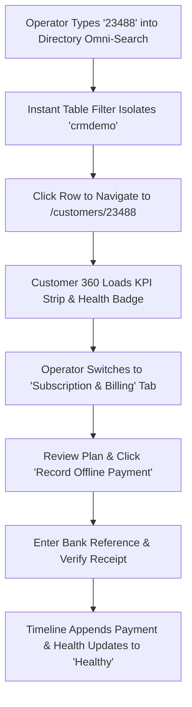

# Product Requirements Document (PRD)
## Sprint 3: Customer Management & Customer 360

---

### 1. Document Control & Metadata
- **Document Title:** Product Requirements Document - Sprint 3: Customer Management & Customer 360
- **Document Version:** 1.0.0
- **Status:** In Progress
- **Author:** CICOD Product & Architecture Team
- **Target Sprint:** Sprint 3 (Week 4)
- **Target Audience:** Customer Success Managers, Support Leads, Collections Officers, Frontend & Backend Engineers
- **Last Updated:** 2026-10-13

---

### 2. Executive Summary & Core Deliverables
In the legacy CRM, searching for a merchant required manually picking a "Filter Type" dropdown first, or the search did nothing. Customer health was invisible (an account 40+ days overdue still showed a green "Active" badge). Pagers were broken beyond record #1,340 of 13,355 records. Customer detail views locked to a single hard-coded record ("Obiora"), and high-risk actions like "Suspend Customer" were unconfirmed buttons placed directly next to "Update Customer". Furthermore, tenant onboarding stopped after collecting contact info, leaving new accounts unbilled and without plan bindings.

Sprint 3 delivers an enterprise-grade customer directory with instant omni-search, operational segment tabs, a dynamic **Customer 360 View** with derived health badges, safe suspension workflows, and a **4-Step Onboarding Wizard** that binds plans on creation.

#### Core Deliverables
1. **Segmented Customer Directory (`s3-d1`):** Real-time segments: Trials Ending, Renewal Overdue, Onboarding Stuck, Suspended, All 13,355. *[Tags: Directory, Segments, Omni-Search]*
2. **Customer 360 Console (`s3-d2`):** Summary strip (MRR, licenses, renewal), urgent alert banner, and 5 consolidated tabs. *[Tags: Customer 360, Health Badges, Timeline]*
3. **4-Step New Customer Wizard (`s3-d3`):** Business (domain check) → Primary Contact → Plan Selection → Review & Provision. *[Tags: Onboarding, Provisioning, Wizard]*

### 3. Product Vision & Strategic Objectives
- **Zero-Friction Discovery:** Any support agent or account executive must locate a tenant profile in `< 2 seconds` using any piece of customer identifier.
- **Proactive Churn Intervention:** Derived health badges (`Due Soon`, `Overdue`, `Trial Expiring`) surface at-risk accounts before service disruption occurs.
- **Complete Operational Context:** Unify contracts, licenses, tickets, and internal team comments into a single scrollable pane.

---

### 4. Target Audience & User Personas
- **Customer Success Manager:** Audits onboarding progression and reaches out to merchants entering the final 7 days of their free trial.
- **Support Operations Agent:** Quickly validates active subscription tiers, seat limits, and ticket history during merchant inquiry calls.
- **Collections & Risk Specialist:** Identifies delinquent accounts, reviews billing reminders, and safely suspends non-compliant tenants.

---

### 5. Scope Boundaries

#### 5.1 In-Scope Deliverables
- **Segmented Customer Directory:** Real-time segments: Trials Ending, Renewal Overdue, Onboarding Stuck, Suspended, All 13,355.
- **Customer 360 Console:** Summary strip (MRR, licenses, renewal), urgent alert banner, and 5 consolidated tabs.
- **4-Step New Customer Wizard:** Business (domain check) → Primary Contact → Plan Selection → Review & Provision.

#### 5.2 Out-of-Scope
- Direct customer banking debit automation (handled in Sprint 4 Billing & Collections).
- End-user merchant self-management portal (this PRD governs internal staff CRM).
- Live telephony/call recording embedded in browser.

---

### 6. Comprehensive User Flow & Journey Maps

#### 6.1 Primary Happy Path Flow


#### 6.2 Alternate & Exception Flows
- **Overdue Account Triage:** User clicks "Renewal Overdue" segment tab. Directory lists all accounts with unpaid invoices. Selecting an account displays a top red banner: *"⚠ Renewal overdue by 41 days. ₦8,000 due. [Send Invoice] [Suspend]"*.
- **Suspension Safety Intercept:** Operator clicks "Suspend Customer" from header dropdown. Modal prompts for mandatory reason code ("Non-payment past grace period") and audit explanation. Submitting updates status to `Suspended`, revokes API keys, and logs event to Activity timeline.
- **Subdomain Collision in Onboarding:** In Step 1 of Onboarding, user types `demo`. Live validator checks registry and displays: *"Subdomain 'demo.cicod.com' is already registered. Please choose another."*

---

### 7. Functional Requirements (FRs)

#### 7.1 Customer Directory & Omni-Search
- **FR-3.1.1:** Single search input must execute across Company Name, Subdomain, CICOD Number, Contact Email, and Phone number without prior dropdown selection.
- **FR-3.1.2:** Search input must fire queries with a 250ms debounce and update URL query params (`?q=`).
- **FR-3.1.3:** Segment filter tabs must include live count badges: *All*, *Trials Ending (≤7d)*, *Renewal Overdue*, *Onboarding Stuck (>14d)*, *Suspended*.
- **FR-3.1.4:** Customer list table rows must display:
  - Cell 1: Company Name + CICOD ID (line 1), Contact Name + Email (line 2).
  - Cell 2: Sector and Business Type.
  - Cell 3: Plan tier name and monthly billable value.
  - Cell 4: Derived Health Badge (`Healthy`, `Due Soon`, `Overdue [n]d`, `Trial [n]d`, `Suspended`).
  - Cell 5: Quick actions menu (`View Profile`, `Copy Subdomain`, `Log Note`).

#### 7.2 Customer 360 Hub
- **FR-3.2.1:** Route `/crm/customer-mgt/customers/[id]` must dynamically fetch entity details using URL param.
- **FR-3.2.2:** Profile header must present: Company Name, CICOD ID, Lifecycle State, Health Badge, Subdomain hyperlink, and Industry Sector.
- **FR-3.2.3:** KPI Summary strip must render 5 standardized cards: Plan Tier, MRR, Users vs License limit, Next Renewal Date, Last Payment.
- **FR-3.2.4:** Overview Tab must display onboarding lifecycle progress tracker, primary business details, authorized contact persons, and uploaded compliance docs.
- **FR-3.2.5:** Subscription & Billing Tab must detail active commercial plan, add-on modules, invoice history with download links, and "Record Offline Payment" action.
- **FR-3.2.6:** Users Tab must list registered tenant staff, roles, and seat consumption progress bar.
- **FR-3.2.7:** Tickets Tab must display active customer support tickets with severity and status badges.
- **FR-3.2.8:** Activity & Notes Tab must provide an inline note composer (`textarea` + "Post Note" button) and an append-only timeline interleaving system events and staff comments.

#### 7.3 Safe Suspension Mechanism
- **FR-3.3.1:** Suspend action must be guarded inside header actions menu with red danger styling.
- **FR-3.3.2:** Suspension modal must require selection of `reasonCode` and minimum 10-character explanation in `notes`.
- **FR-3.3.3:** Execution must update tenant state to `Suspended` and write an audit event into the timeline.

#### 7.4 4-Step Onboarding Wizard
- **FR-3.4.1:** Step 1 (Business Info): Company Name, Subdomain (with debounced availability check), Sector, Business Type.
- **FR-3.4.2:** Step 2 (Primary Contact): Full Name, Work Email, Phone Number (auto-formatted to E.164: `+234...`).
- **FR-3.4.3:** Step 3 (Plan Selection): Product/Bundle picker, Billing Period (Monthly/Annual), Trial toggle.
- **FR-3.4.4:** Step 4 (Review & Provision): Summary confirmation; submits and redirects to new Customer 360 profile.

---

### 8. Non-Functional Requirements (NFRs)

#### 8.1 Performance & Latency
- Omni-search queries must return filtered results in `< 180ms` against a 15,000+ customer dataset.
- Customer 360 view data must load in a single consolidated API payload in `< 350ms`.

#### 8.2 Security & Compliance
- Role-based access control: Only users with `ROLE_RISK_OFFICER` or `ROLE_SUPERADMIN` can execute tenant suspension or reactivation.
- Customer contact numbers must be sanitized and encrypted at rest in accordance with NDPR and GDPR requirements.

#### 8.3 Reliability & Availability
- Derived health calculation logic must be deterministic and testable via pure TypeScript functions.
- If network disconnection occurs during onboarding submission, retry idempotency key prevents duplicate tenant creation.

#### 8.4 Usability & Accessibility
- Clean typography hierarchy with monospaced styling for CICOD numbers and monetary figures.
- Direct copy buttons with clipboard tooltips for Subdomains, Emails, and CICOD IDs.

---

### 9. Detailed User Stories & Sprint Tasks

#### US-3.1 (Deliverable: Segmented Customer Directory): Real-Time Segmented Customer Directory
*As a Account Executive, I want a lightning-fast customer directory with omni-search and real-time operational segments so that I can instantly find any customer by company name, domain, CICOD number, or phone.*

- **Acceptance Criteria**:
  - Instant omni-search responds within < 200ms across 13,355 merchants.
  - Segment chips filter by Trials Ending, Renewal Overdue, Onboarding Stuck, and Suspended.
  - Health badges (Healthy, Due Soon, Overdue, Suspended) compute from subscription timestamps.

- **Outlined Sprint Tasks**:
  - [ ] `s3-1` (FRONTEND · L): **Build Customers directory with omni-search & segment pills** - *Single query box across company, domain, CICOD #, email, phone with URL state.*
  - [ ] `s3-2` (FRONTEND · M): **Compute Customer Health badges dynamically** - *Derive Healthy, Trial, Due Soon, Overdue, Suspended from subscription timestamps.*
  - [ ] `s3-7` (FRONTEND · S): **URL query parameter sync for customer search & active segment** - *Persist customer search filters and segment selection in URL query params.*

#### US-3.2 (Deliverable: Customer 360 Console): Comprehensive Customer 360 Workspace
*As a Customer Success Manager, I want a unified Customer 360 view with top KPI strip, urgent alerts banner, and 5 consolidated tabs so that I have complete visibility into a customer's subscription, billing status, tickets, and user activity in one screen.*

- **Acceptance Criteria**:
  - Summary strip highlights Plan, MRR, Seats used, Renewal date, and Last payment.
  - Urgent banner surfaces overdue balances or pending dunning actions.
  - 5 tabs: Overview, Invoices & Billing, Users & Seats, Support Tickets, Activity Timeline.

- **Outlined Sprint Tasks**:
  - [ ] `s3-3` (FRONTEND · M): **Build Customer 360 header & summary KPI strip** - *Display Plan, MRR, Users vs Seats, Next Renewal, Last Payment with status badge.*
  - [ ] `s3-4` (FRONTEND · XL): **Consolidate 7 tabs into 5 (Overview, Billing, Users, Tickets, Activity)** - *Include unified Activity & Notes timeline and eliminate empty Addon placeholder.*
  - [ ] `s3-6` (FRONTEND · S): **Implement safe Suspend workflow with mandatory reason** - *Move suspend into ⋯ menu with confirmation dialog logging note to timeline.*

#### US-3.3 (Deliverable: 4-Step New Customer Wizard): Guided Tenant Onboarding & Plan Assignment
*As a Onboarding Coordinator, I want a 4-step wizard to register business info, primary contact, assign a live product plan, and provision tenant so that new merchants are correctly onboarded with immediate billing capability and zero orphan records.*

- **Acceptance Criteria**:
  - Step 1 validates company domain uniqueness before continuing.
  - Step 2 creates primary admin contact with phone and role.
  - Step 3 binds a live catalogue plan so the merchant is immediately billable.
  - Step 4 summarizes and provisions the tenant with generated CICOD ID.

- **Outlined Sprint Tasks**:
  - [ ] `s3-5` (FRONTEND · L): **Implement 4-step New Customer onboarding wizard** - *Connect business info directly to catalogue plan picker so customer is billable.*
  - [ ] `s3-8` (FRONTEND · S): **Add domain availability check and company duplication filter** - *Validate tenant domain and tax identification uniqueness before submission.*
  - [ ] `s3-9` (BACKEND · M): **Tenant provisioning REST integration & error handling** - *Backend transactional tenant creation, license assignment, and audit log.*

### 10. Technical Architecture, Data Models & API Contracts

#### Customer Entity Schema
```typescript
export interface CustomerListItem {
  id: string;
  cicodNumber: string;
  companyName: string;
  subdomain: string;
  primaryContact: {
    name: string;
    email: string;
    phone: string;
  };
  sector: string;
  businessType: string;
  plan: {
    code: string;
    name: string;
    monthlyValue: number;
    currency: "NGN" | "USD" | "GBP";
  };
  status: "Active" | "Pending" | "Suspended" | "Archived";
  health: "Healthy" | "Due Soon" | "Overdue" | "Trial" | "Suspended";
  overdueDays?: number;
  trialRemainingDays?: number;
  nextRenewalDate: string;
  lastPaymentDate?: string;
  createdAt: string;
}

export interface Customer360DTO extends CustomerListItem {
  licenseAllocation: {
    usedSeats: number;
    totalSeats: number;
    storageUsedGb: number;
    storageLimitGb: number;
  };
  invoices: Array<{
    id: string;
    invoiceNumber: string;
    amount: number;
    currency: string;
    status: "Paid" | "Pending" | "Overdue";
    dueDate: string;
  }>;
  tickets: Array<{
    id: string;
    ticketNumber: string;
    subject: string;
    severity: "Low" | "Medium" | "High" | "Critical";
    status: "Open" | "In Progress" | "Resolved";
    updatedAt: string;
  }>;
  activities: Array<{
    id: string;
    type: "NOTE" | "PAYMENT" | "STATUS_CHANGE" | "INVOICE";
    author: string;
    title: string;
    description: string;
    createdAt: string;
  }>;
}
```

#### REST API Endpoints
| Method | Endpoint | Description | Status Codes |
|---|---|---|---|
| `GET` | `/api/v2/customers` | Directory omni-search with segment filters | `200` |
| `GET` | `/api/v2/customers/{id}` | Consolidated Customer 360 record | `200`, `404` |
| `POST` | `/api/v2/customers` | Create and provision customer with plan | `201`, `400` |
| `POST` | `/api/v2/customers/{id}/suspend` | Suspend tenant with mandatory audit reason | `200`, `422` |
| `POST` | `/api/v2/customers/{id}/reactivate` | Reactivate suspended tenant | `200` |
| `POST` | `/api/v2/customers/{id}/notes` | Post operator note to Activity timeline | `201` |

---

#### REST API Contracts

| Method | Endpoint | Functional Contract & Payload Expectation |
|---|---|---|
| `GET` | `/api/v2/customers?q={query}&segment={seg}&page={p}` | Omni-search returning derived health, plan, and lifecycle stage. |
| `GET` | `/api/v2/customers/{id}` | Single Customer 360 graph including subscription, seats, and open tickets. |
| `POST` | `/api/v2/customers` | Provisions merchant tenant and binds initial product plan. |
| `POST` | `/api/v2/customers/{id}/suspend` | Suspends tenant; requires reason code and operator notes. |


---

### 11. Edge Cases & Error Handling Strategies
- **Non-Existent Customer ID:** If `/customers/99999` is requested, UI renders a helpful 404 state with "Return to Directory" CTA.
- **Duplicate Subdomain:** Onboarding form validates subdomain uniqueness on blur; blocks submission if taken.
- **Unformatted International Phone:** Sanitizer strips local zero prefixes and attaches proper country code (e.g. `0907...` → `+234 907...`).
- **Concurrent Suspension & Payment:** If a payment confirms while an operator suspends, webhook resolves customer to `Active` and alerts operator.

---

### 12. Success Metrics & Key Performance Indicators (KPIs)
- **Search Success Rate:** 100% of staff searches locate records without needing assistance or direct database queries.
- **Mean Time to Customer Context (MTCC):** Reduced from 4.5 minutes across disconnected pages to `< 15 seconds` via Customer 360.
- **Onboarding Plan Attachment:** 100% of newly created tenants have an assigned commercial tier at creation.
- **Suspension Audit Compliance:** 100% of suspended accounts have logged operator reasons.

---

### 13. Release Plan, Milestones & Definition of Done (DoD)
- **Milestone 3.1 (Days 1–3):** Omni-search customer table with URL sync and segment tabs.
- **Milestone 3.2 (Days 4–7):** Parameterized Customer 360 view with 5 KPI metrics and 5 consolidated tabs.
- **Milestone 3.3 (Days 8–9):** Safe suspension drawer and Activity/Notes timeline composer.
- **Milestone 3.4 (Day 10):** 4-step onboarding wizard with plan selection and integration tests.

---

#### Definition of Done (DoD)
- [ ] Clicking any customer opens their specific CICOD number (no mock customer locking).
- [ ] Overdue renewals display prominent alert banner showing exact days past due.
- [ ] Suspending a customer requires selecting a reason and immediately records to Activity.

---

### 14. Architectural Risks, Mitigations & Dependencies

#### Key Architectural Risks & Mitigations
- **Risk & Mitigation:** Over-fetching customer relationships in list view (must use lean list DTOs).
- **Risk & Mitigation:** Duplicate merchant domain registration during onboarding.

#### External & Internal Dependencies
- Database schema migrations and tenant isolation verified prior to deployment.
- Google Fonts and Lucide icon assets bundled locally without unauthenticated CDN lock-in.

---

### 15. Open Questions, Decisions & Next Steps

#### Open Architectural Questions & Decisions
- **Question:** What algorithmic formula determines an account health score (Healthy, Trial, Due Soon, Overdue)?
  - *Decision / Recommendation:* Composite score: 50% invoice payment timeliness + 30% user active sessions in last 30 days + 20% open tickets.
- **Question:** Can customer records be hard-deleted from the database?
  - *Decision / Recommendation:* Hard deletions strictly prohibited for regulatory compliance; soft archiving with mandatory reason capture only.

#### Next Sprint Handover & Follow-ups
- Verify acceptance criteria and automated tests are green before advancing to Sprint 4 (Billing, Payments, Collections & Dunning).
- Conduct sprint retrospective and synchronize status tokens in roadmap database.

### 16. Test Cases, Use Cases & QA Acceptance Scenarios

| Test ID | Category | Severity | Persona | Title | Expected Outcome |
|---|---|---|---|---|---|
| `TC-3.1` | Happy Path | **Critical** | Customer Success Lead | Unified Customer 360 Consolidated Timeline | Timeline aggregates events chronologically with entity badges. Filtering by 'Billing' displays only invoice-related entries in < 50ms without full page reload. |
| `TC-3.2` | Edge Case | **Critical** | Compliance Auditor | Defensive Guard on Customer Account Archiving | Modal displays warning: 'Customer has active subscription Pro Cloud. Archiving will pause recurring billing and cancel scheduled invoices.' Mandatory reason dropdown required before proceed button enables. |
| `TC-3.3` | Happy Path | **High** | Account Manager | Account Health Score Calculation Engine | Health badge renders Healthy (green) with 95/100 composite score breakdown tooltip (Payment timeliness: 100%, Engagement: 90%, Tickets: 95%). |
| `TC-3.4` | Performance & Scale | **High** | QA Automation Engineer | High-Performance FilterBar Debounce on 10,000 Customer Records | Debounce delay of 250ms prevents intermediate render churn; single query executes at end of typing stream; table filter response executes in < 30ms. |

#### Detailed Validation Procedures

##### [TC-3.1] Unified Customer 360 Consolidated Timeline
- **Category:** Happy Path | **Severity:** Critical | **Persona:** Customer Success Lead | **Story:** `US-3.1`
- **Preconditions:** Customer #1044 has 3 invoices, 2 support tickets, and 1 renewal.
- **Execution Steps:**
  1. Open Customer 360 overview for #1044.
  2. Inspect Activity Stream.
  3. Filter stream by 'Billing'.
- **Pass Criteria:** Timeline aggregates events chronologically with entity badges. Filtering by 'Billing' displays only invoice-related entries in < 50ms without full page reload.

##### [TC-3.2] Defensive Guard on Customer Account Archiving
- **Category:** Edge Case | **Severity:** Critical | **Persona:** Compliance Auditor | **Story:** `US-3.3`
- **Preconditions:** Customer has active monthly subscription in status Live.
- **Execution Steps:**
  1. Open customer actions menu.
  2. Click 'Archive Customer'.
  3. Observe ConfirmDialog.
- **Pass Criteria:** Modal displays warning: 'Customer has active subscription Pro Cloud. Archiving will pause recurring billing and cancel scheduled invoices.' Mandatory reason dropdown required before proceed button enables.

##### [TC-3.3] Account Health Score Calculation Engine
- **Category:** Happy Path | **Severity:** High | **Persona:** Account Manager | **Story:** `US-3.2`
- **Preconditions:** Customer has 0 overdue invoices and 15 team logins this week.
- **Execution Steps:**
  1. View Health Badge in customer header.
  2. Hover over health pill.
- **Pass Criteria:** Health badge renders Healthy (green) with 95/100 composite score breakdown tooltip (Payment timeliness: 100%, Engagement: 90%, Tickets: 95%).

##### [TC-3.4] High-Performance FilterBar Debounce on 10,000 Customer Records
- **Category:** Performance & Scale | **Severity:** High | **Persona:** QA Automation Engineer | **Story:** `US-3.1`
- **Preconditions:** Customer dataset populated with 10,000 rows.
- **Execution Steps:**
  1. Type rapidly into Customer search input: 'Zenith Logistics'.
  2. Monitor network/render dispatch frequency.
- **Pass Criteria:** Debounce delay of 250ms prevents intermediate render churn; single query executes at end of typing stream; table filter response executes in < 30ms.

