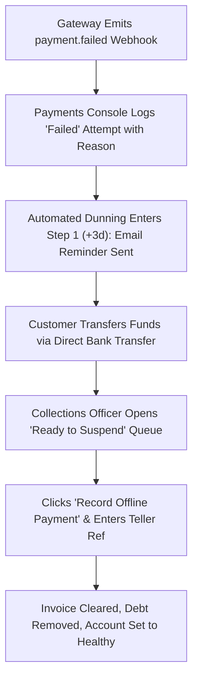

# Product Requirements Document (PRD)
## Sprint 4: Billing, Payments, Collections & Dunning

---

### 1. Document Control & Metadata
- **Document Title:** Product Requirements Document - Sprint 4: Billing, Payments, Collections & Dunning
- **Document Version:** 1.0.0
- **Status:** In Progress
- **Author:** CICOD Product & Architecture Team
- **Target Sprint:** Sprint 4 (Week 5)
- **Target Audience:** Finance Directors, Billing Specialists, Collections Officers, Frontend & Backend Engineers
- **Last Updated:** 2026-10-13

---

### 2. Executive Summary & Core Deliverables
In the legacy platform, the subscription payments table marked every transaction as "CONFIRMED" despite 87% having failed at payment gateways. Financial aggregates were inaccurate, dunning policies covered only 2 of 7 billing models leaving overdue merchants unchased, and manual bank transfer reconciliation lacked structured audit controls and mandatory transaction reference validation.

Sprint 4 delivers an end-to-end financial operations cockpit: a **Billing Overview Dashboard** with reconciled MRR and recovery rates, a **Payments Console** reflecting authentic gateway statuses (`Paid`, `Failed`, `Pending`, `Refunded`) with retry logs, an actionable **Collections Workbench** with an offline reconciliation modal, and a visual **Dunning Policy Timeline Editor**.

#### Core Deliverables
1. **Billing Overview & Executive Dashboard (`s4-d1`):** Live KPIs: Total MRR, Outstanding Collections, Failed Transactions, Dunning Recovery Rate. *[Tags: FinOps, KPIs, Revenue]*
2. **Payments Console & Attempt Drawer (`s4-d2`):** True statuses (Paid, Failed, Pending, Refunded), transaction retry grouping, payment link CTA. *[Tags: Payments, Audit, Reconciliation]*
3. **Collections & Dunning Policy Builder (`s4-d3`):** Queue of overdue accounts, Record Offline Payment modal, and visual reminder timeline. *[Tags: Collections, Dunning, Timeline]*

### 3. Product Vision & Strategic Objectives
- **Financial Truth & Integrity:** Eliminate illusory "CONFIRMED" states; ensure every Naira, Dollar, and Pound reflects settled bank or gateway funds.
- **Automated Revenue Recovery:** Minimize involuntary churn by chasing expiring cards and failed payments with automated multi-channel cadences.
- **Auditable Reconciliation:** Ensure every offline transaction has verifiable banking documentation before ledger updates.

---

### 4. Target Audience & User Personas
- **Finance Director:** Monitors monthly recurring revenue trends, accounts receivable aging, and net recovery rates.
- **Billing Specialist:** Investigates gateway failure codes (insufficient funds, expired cards) and coordinates invoice re-issuance.
- **Credit Control & Collections Officer:** Manages merchants approaching the end of grace periods, reviewing disputes or recording bank transfers.

---

### 5. Scope Boundaries

#### 5.1 In-Scope Deliverables
- **Billing Overview & Executive Dashboard:** Live KPIs: Total MRR, Outstanding Collections, Failed Transactions, Dunning Recovery Rate.
- **Payments Console & Attempt Drawer:** True statuses (Paid, Failed, Pending, Refunded), transaction retry grouping, payment link CTA.
- **Collections & Dunning Policy Builder:** Queue of overdue accounts, Record Offline Payment modal, and visual reminder timeline.

#### 5.2 Out-of-Scope
- Direct integration with general ledger ERPs (SAP/NetSuite) — targeted for post-v2 release.
- Physical card terminal (POS) hardware firmware updates.
- Customer-facing payment gateway checkout modal (backend webhook ingestion focus).

---

### 6. Comprehensive User Flow & Journey Maps

#### 6.1 Primary Happy Path Flow


#### 6.2 Alternate & Exception Flows
- **Disputed Invoice Pause:** Merchant disputes bill. Collections officer clicks "Pause Chasing" and selects reason "Billing Dispute". Account is moved to the "Paused" tab, and automated dunning reminders are halted.
- **Grace Period Expiry (Auto-Suspend Mode):** If a dunning policy has "Auto-suspend" toggled ON and the account passes Day 14 without payment, system transitions tenant to `Suspended` and notifies customer success.
- **Duplicate Offline Reference Check:** If an officer enters a bank reference already present in the ledger, the system blocks submission with a duplicate alert: *"Reference REF-88492 was already recorded on 2026-09-12"*.

---

### 7. Functional Requirements (FRs)

#### 7.1 Billing Overview & Metrics
- **FR-4.1.1:** Dashboard must calculate Total MRR, Outstanding Collections, 7-day Payment Failures, and Dunning Recovery %.
- **FR-4.1.2:** Metric cards must act as interactive filters (e.g., clicking "Failed Payments" opens `/crm/billing/payments?status=Failed`).

#### 7.2 Payments Console & Gateway Retries
- **FR-4.2.1:** Transaction table must display authentic statuses: `Paid`, `Failed`, `Pending`, `Refunded`.
- **FR-4.2.2:** Multiple automated retry attempts on a single invoice must collapse into an expandable order row.
- **FR-4.2.3:** Clicking a row must slide open the Attempt Detail Drawer showing timestamp, card last 4 digits, gateway response (e.g. `Insufficient Funds`), and reference ID.
- **FR-4.2.4:** Drawer must offer "Send Payment Link" CTA triggering customer email/SMS with secure checkout URL.

#### 7.3 Collections Workbench
- **FR-4.3.1:** Workbench must segment accounts into 4 views: `All Overdue`, `In Grace Period`, `Ready to Suspend`, and `Paused`.
- **FR-4.3.2:** "Record Offline Payment" modal must require: Settled Amount, Payment Method, Payment Date, Bank Reference Number, and Internal Notes.
- **FR-4.3.3:** Submitting offline settlement must immediately update invoice to `Paid`, clear overdue balance, and set customer health badge to `Healthy`.
- **FR-4.3.4:** "Pause Chasing" action must require documented reason and target resume date.

#### 7.4 Dunning Policy Studio
- **FR-4.4.1:** Must display visual coverage meter: *"Coverage: X of Y billing models covered by active policy"*.
- **FR-4.4.2:** Visual timeline must support drag-and-drop or stepper addition of pre-due (-14d to -1d) and post-due (+1d to +30d) reminder steps.
- **FR-4.4.3:** Each step must support Step Type (`Reminder`, `Warning`, `Final Notice`), Email Template, and SMS Template selection.
- **FR-4.4.4:** Right-hand pane must display live rendered template preview using placeholder tenant data.
- **FR-4.4.5:** Policy options must include Grace Period days, "Suspend automatically" switch, and "Skip customers with pending bank transfer" switch.

---

### 8. Non-Functional Requirements (NFRs)

#### 8.1 Performance & Latency
- Webhook processor must handle incoming payment gateway payloads in `< 400ms`.
- Billing overview summary cards must load cached rollups in `< 300ms`.

#### 8.2 Security & Compliance
- PCI-DSS Compliance: Full credit card numbers and CVV codes must NEVER be stored, logged, or surfaced in the UI. Only card brand, expiry, and last 4 digits are permitted.
- Ledger Immutability: Offline payment records cannot be hard deleted; reversals require formal credit memo entries.

#### 8.3 Reliability & Availability
- Idempotent payment webhook ingestion: Duplicate webhook events from Paystack/Flutterwave/Stripe must not double-credit accounts.
- Dunning cron execution must maintain persistent offset locks to prevent duplicate customer message delivery.

#### 8.4 Usability & Accessibility
- Status indicators must use dual encoding (color + text label + icon) for color-blind accessibility.
- Monetary figures must format with currency symbols and two decimal places (e.g., `₦124,500.00`).

---

### 9. Detailed User Stories & Sprint Tasks

#### US-4.1 (Deliverable: Billing Overview & Executive Dashboard): Executive Financial Health & MRR Dashboard
*As a Chief Financial Officer, I want an executive billing dashboard with true MRR, outstanding receivables, failed payments count, and recovery rates so that leadership can evaluate recurring cash flow and identify collection risks in real time.*

- **Acceptance Criteria**:
  - Displays Total MRR, Outstanding Collections, Failed Transactions, and Dunning Recovery Rate.
  - Month-over-month trends highlight revenue growth and churn risk.
  - Visual distribution breakdown by payment channel (Card, Direct Debit, Bank Transfer).

- **Outlined Sprint Tasks**:
  - [ ] `s4-7` (FRONTEND · M): **Build executive Billing Overview KPI cards and revenue charts** - *Display monthly revenue run-rate, failed transactions count, and collection recovery trend.*
  - [ ] `s4-8` (BACKEND · M): **Implement financial aggregations endpoint for live billing metrics** - *High-performance aggregation query calculating MRR and overdue balances across currencies.*
  - [ ] `s4-9` (QA · S): **Automated reconciliation test for multi-currency MRR calculation** - *Validate currency rate conversion and zero double-counting on upgraded subscriptions.*

#### US-4.2 (Deliverable: Payments Console & Attempt Drawer): Real Payment Transaction Auditing & Retry History
*As a Billing Operations Specialist, I want a payments ledger displaying true gateway transaction states with expandable retry history drawers so that I can explain payment failures to customers without guessing between gateway errors and bank declines.*

- **Acceptance Criteria**:
  - True status pills: Paid (green), Failed (red), Pending (amber), Refunded (slate).
  - Attempt drawer groups all retries under the parent order with error messages.
  - Generate Payment Link CTA allows manual recovery over email or SMS.

- **Outlined Sprint Tasks**:
  - [ ] `s4-1` (FRONTEND · L): **Build Payments table with real statuses & attempt drawer** - *Group retries under single orders; display gateway error codes and card info.*
  - [ ] `s4-10` (FRONTEND · S): **Add payment link generation modal with copyable URL** - *Create one-click recovery link for failed transactions with custom expiry window.*
  - [ ] `s4-11` (BACKEND · L): **Payment gateway webhook ingestion handler for state updates** - *Asynchronously process payment gateway webhooks for charge success, decline, and chargebacks.*

#### US-4.3 (Deliverable: Collections & Dunning Policy Builder): Automated Dunning Rules & Past-Grace Collections
*As a Credit Control Manager, I want a past-grace collections queue, offline payment recorder, and visual dunning reminder timeline builder so that we can recover overdue subscriptions through scheduled automated reminders and manual bank reconciliation.*

- **Acceptance Criteria**:
  - 'Ready to suspend' queue isolates overdue merchants past grace threshold.
  - Record Offline Payment validates teller reference, clears debt, and logs note.
  - Dunning Policy editor provides visual day-by-day reminder timeline (SMS/Email).

- **Outlined Sprint Tasks**:
  - [ ] `s4-2` (FRONTEND · M): **Build Collections workbench with 'Ready to suspend' queue** - *Table of past-grace accounts requiring human suspension decisions.*
  - [ ] `s4-3` (FRONTEND · M): **Implement 'Record Offline Payment' modal with bank reference** - *Validate required reference, reconcile invoice, and clear overdue status.*
  - [ ] `s4-4` (FRONTEND · XL): **Build Dunning Policy editor with interactive timeline** - *Drag/configure days before/after due date with SMS/email template bindings.*
  - [ ] `s4-5` (FRONTEND · S): **Create Dunning Policy coverage indicator** - *Visual strip showing which billing models lack a live chasing policy.*
  - [ ] `s4-6` (BACKEND · XL): **Implement Automated Dunning Cron & Webhook processor** - *Nightly evaluation of grace periods and message dispatch queue.*

### 10. Technical Architecture, Data Models & API Contracts

#### Payment & Dunning Schemas
```typescript
export interface PaymentOrderDTO {
  id: string;
  orderNumber: string;
  customerId: string;
  companyName: string;
  amount: number;
  currency: "NGN" | "USD" | "GBP";
  status: "Paid" | "Failed" | "Pending" | "Refunded";
  billingModel: string;
  createdAt: string;
  latestAttempt?: {
    attemptId: string;
    gateway: "PAYSTACK" | "FLUTTERWAVE" | "STRIPE" | "OFFLINE";
    gatewayMessage: string;
    cardLast4?: string;
    cardBrand?: string;
    executedAt: string;
  };
}

export interface OfflinePaymentDTO {
  customerId: string;
  invoiceId: string;
  amount: number;
  currency: string;
  paymentMethod: "BANK_TRANSFER" | "CASH" | "POS" | "CHEQUE";
  paymentDate: string;
  bankReferenceNumber: string;
  receiptAttachmentUrl?: string;
  notes: string;
}

export interface DunningStep {
  id: string;
  offsetDays: number; // e.g. -7, -3, 1, 7, 14
  type: "REMINDER" | "WARNING" | "FINAL_NOTICE";
  emailTemplateId?: string;
  smsTemplateId?: string;
}

export interface DunningPolicy {
  id: string;
  name: string;
  billingModel: string;
  gracePeriodDays: number;
  autoSuspend: boolean;
  skipPausedCustomers: boolean;
  skipPendingTransfers: boolean;
  steps: DunningStep[];
  isActive: boolean;
}
```

#### REST API Endpoints
| Method | Endpoint | Description | Status Codes |
|---|---|---|---|
| `GET` | `/api/v2/billing/overview` | Executive financial pulse and recovery metrics | `200` |
| `GET` | `/api/v2/billing/payments` | True payment transactions with attempts | `200` |
| `GET` | `/api/v2/billing/payments/{id}/attempts` | Slide-out attempt details list | `200`, `404` |
| `POST` | `/api/v2/billing/payments/record-offline` | Record offline bank payment | `201`, `422` |
| `POST` | `/api/v2/billing/payments/send-link` | Dispatch checkout link via Email/SMS | `200` |
| `GET` | `/api/v2/billing/collections` | Triage queue of delinquent accounts | `200` |
| `GET` | `/api/v2/billing/dunning/policies` | Dunning policies with coverage status | `200` |
| `POST` | `/api/v2/billing/dunning/policies` | Save dunning policy cadence | `200`, `400` |

---

#### REST API Contracts

| Method | Endpoint | Functional Contract & Payload Expectation |
|---|---|---|
| `GET` | `/api/v2/billing/overview` | Returns aggregate MRR, failed transaction counts, and collections total. |
| `GET` | `/api/v2/billing/payments` | Filtered payments with grouped attempt history and true statuses. |
| `POST` | `/api/v2/billing/payments/record-offline` | Records manual bank transfer with mandatory teller/transaction ref. |
| `GET` | `/api/v2/billing/dunning/policies` | Lists policies with assigned billing model coverage map. |


---

### 11. Edge Cases & Error Handling Strategies
- **Partial Payments:** If a customer transfers `₦50,000` on a `₦100,000` invoice, the system logs a partial payment and keeps remaining balance in Collections.
- **Simultaneous Webhook & Bank Transfer:** If an automated debit settles while an offline transfer is pending verification, the system flags the invoice for manual review to prevent double collection.
- **Missing SMS Provider Balance:** If SMS credits expire during dunning dispatch, the system falls back to email and logs a critical alert to the admin dashboard.

---

### 12. Success Metrics & Key Performance Indicators (KPIs)
- **Status Accuracy:** 100% elimination of false "CONFIRMED" displays.
- **Dunning Coverage:** 100% of commercial billing models covered by active dunning policies.
- **Overdue Invoices Settled:** > 35% automated recovery rate for overdue subscription accounts.
- **Offline Settlement Speed:** Offline bank transfers cleared in `< 2 minutes` by Collections staff.

---

### 13. Release Plan, Milestones & Definition of Done (DoD)
- **Milestone 4.1 (Days 1–2):** Billing KPI Overview & drill-down metrics.
- **Milestone 4.2 (Days 3–5):** True-status Payments console and attempt detail slide-out drawer.
- **Milestone 4.3 (Days 6–7):** Collections Workbench and offline payment reconciliation modal.
- **Milestone 4.4 (Days 8–10):** Dunning visual timeline builder and end-to-end webhook integration tests.

---

#### Definition of Done (DoD)
- [ ] Payments console shows true failed count matching payment gateway webhooks.
- [ ] Recording an offline payment removes customer from Collections queue immediately.
- [ ] Dunning steps cannot be saved with blank or unassigned communication templates.

---

### 14. Architectural Risks, Mitigations & Dependencies

#### Key Architectural Risks & Mitigations
- **Risk & Mitigation:** Chasing customers who have already paid offline before reconciliation is logged.
- **Risk & Mitigation:** Accidental automated suspension of key VIP accounts (mitigated by 'Skip Paused').

#### External & Internal Dependencies
- Database schema migrations and tenant isolation verified prior to deployment.
- Google Fonts and Lucide icon assets bundled locally without unauthenticated CDN lock-in.

---

### 15. Open Questions, Decisions & Next Steps

#### Open Architectural Questions & Decisions
- **Question:** When does automated dunning suspend customer merchant services?
  - *Decision / Recommendation:* Three notifications over 14 days (Day 1, 7, 14); automated access suspension triggered on Day 15 at 00:00 UTC.
- **Question:** How are idempotency keys structured for payment reconciliation?
  - *Decision / Recommendation:* UUIDv4 passed in Idempotency-Key HTTP header with 24-hour Redis TTL cache to prevent double-charges.

#### Next Sprint Handover & Follow-ups
- Verify acceptance criteria and automated tests are green before advancing to Sprint 5 (Growth Pipeline: Leads & Partners).
- Conduct sprint retrospective and synchronize status tokens in roadmap database.

### 16. Test Cases, Use Cases & QA Acceptance Scenarios

| Test ID | Category | Severity | Persona | Title | Expected Outcome |
|---|---|---|---|---|---|
| `TC-4.1` | Happy Path | **Critical** | Billing Accountant | Invoice PDF Generation & Tax / WHT Breakdown | Line items correctly calculate: Subtotal: ₦1,000,000; VAT: +₦75,000; WHT: -₦50,000; Net Payable: ₦1,025,000. PDF generates cleanly with company header and tax ID. |
| `TC-4.2` | Edge Case | **Critical** | Payment Operations Engineer | Payment Double-Charge Prevention via Idempotency Key | Submit button immediately locks into loading state with spinner. Both requests send identical Idempotency-Key header; backend returns HTTP 200 for the first and deduplicates the second, ensuring customer is charged exactly once. |
| `TC-4.3` | Happy Path | **High** | Collections Specialist | Three-Stage Dunning Workflow with Automated Grace Period | Day 1: Dunning Stage 1 email sent (Soft Reminder). Day 7: Stage 2 SMS + Email sent (Urgent Notice). Day 14: Final Warning sent. Day 15: Account status transitions to Suspended and webhook notifies tenant gateway. |
| `TC-4.4` | Security / RBAC | **High** | Treasury Officer | Offline Bank Transfer Receipt Verification & Maker-Checker Gate | Finance Clerk cannot self-approve their own submission; secondary supervisor role required to approve invoice to 'Paid' status. |

#### Detailed Validation Procedures

##### [TC-4.1] Invoice PDF Generation & Tax / WHT Breakdown
- **Category:** Happy Path | **Severity:** Critical | **Persona:** Billing Accountant | **Story:** `US-4.1`
- **Preconditions:** Customer invoice #INV-2026-0042 with subtotal ₦1,000,000, VAT 7.5%, WHT 5%.
- **Execution Steps:**
  1. Open invoice detail view.
  2. Verify financial calculation summary.
  3. Click 'Download PDF'.
- **Pass Criteria:** Line items correctly calculate: Subtotal: ₦1,000,000; VAT: +₦75,000; WHT: -₦50,000; Net Payable: ₦1,025,000. PDF generates cleanly with company header and tax ID.

##### [TC-4.2] Payment Double-Charge Prevention via Idempotency Key
- **Category:** Edge Case | **Severity:** Critical | **Persona:** Payment Operations Engineer | **Story:** `US-4.2`
- **Preconditions:** Network latency simulated at 2,000ms.
- **Execution Steps:**
  1. User clicks 'Pay Now' on ₦50,000 invoice.
  2. User rapidly double-clicks the submit button within 150ms.
- **Pass Criteria:** Submit button immediately locks into loading state with spinner. Both requests send identical Idempotency-Key header; backend returns HTTP 200 for the first and deduplicates the second, ensuring customer is charged exactly once.

##### [TC-4.3] Three-Stage Dunning Workflow with Automated Grace Period
- **Category:** Happy Path | **Severity:** High | **Persona:** Collections Specialist | **Story:** `US-4.3`
- **Preconditions:** Invoice becomes 1 day overdue.
- **Execution Steps:**
  1. Observe dunning state transitions on Day 1, Day 7, Day 14, and Day 15.
- **Pass Criteria:** Day 1: Dunning Stage 1 email sent (Soft Reminder). Day 7: Stage 2 SMS + Email sent (Urgent Notice). Day 14: Final Warning sent. Day 15: Account status transitions to Suspended and webhook notifies tenant gateway.

##### [TC-4.4] Offline Bank Transfer Receipt Verification & Maker-Checker Gate
- **Category:** Security / RBAC | **Severity:** High | **Persona:** Treasury Officer | **Story:** `US-4.2`
- **Preconditions:** Offline bank transfer receipt uploaded by customer for ₦500,000.
- **Execution Steps:**
  1. Finance Clerk verifies receipt and submits approval.
  2. System checks if Maker is the same as Checker.
- **Pass Criteria:** Finance Clerk cannot self-approve their own submission; secondary supervisor role required to approve invoice to 'Paid' status.

