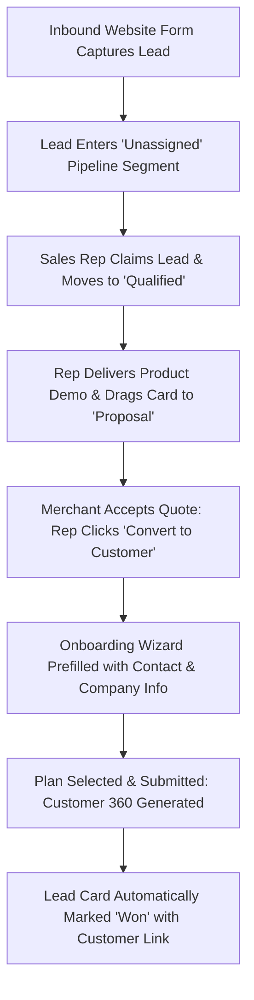

# Product Requirements Document (PRD)
## Sprint 5: Growth Pipeline: Leads & Partners

---

### 1. Document Control & Metadata
- **Document Title:** Product Requirements Document - Sprint 5: Growth Pipeline: Leads & Partners
- **Document Version:** 1.0.0
- **Status:** In Progress
- **Author:** CICOD Product & Architecture Team
- **Target Sprint:** Sprint 5 (Week 6)
- **Target Audience:** Sales Leads, Account Executives, Partner Channel Managers, Frontend & Backend Engineers
- **Last Updated:** 2026-10-13

---

### 2. Executive Summary & Core Deliverables
The legacy `/crm/lead` endpoint threw API error 400 and failed to render, while prospects were siloed in an obsolete `/crm/account/view-prospect` page that crashed with HTTP 500, fragmenting the acquisition funnel. There was no connection between qualified leads and customer onboarding, forcing reps to manually re-type customer details into separate forms. In addition, 400 commercial partners lacked a KYC verification queue, and commission formulas were stored as ambiguous dimensionless numbers like "PERCENT 0.3".

Sprint 5 establishes a high-velocity acquisition suite: an interactive **Leads Pipeline** (with both Table and visual Kanban board views), a frictionless **Convert to Customer** workflow, a dedicated **Partner KYC Verification Queue**, and a **Commission Configuration Engine** featuring real-time worked mathematical examples.

#### Core Deliverables
1. **Interactive Leads Pipeline & Board (`s5-d1`):** Dual table and Kanban board by stage (New → Qualified → Demo → Proposal → Won/Lost). *[Tags: Leads, Kanban, Pipeline]*
2. **One-Click 'Convert to Customer' Workflow (`s5-d2`):** Converts qualified leads into onboarded merchant tenants with prefilled wizard. *[Tags: Conversion, Workflow, Wizard]*
3. **Partners Management & Verification Queue (`s5-d3`):** Manage ICEs, business partners, and delivery affiliates with dedicated verification review. *[Tags: Partners, Affiliates, Verification]*
4. **Commission Plans with Worked Examples (`s5-d4`):** Transparent percentage/fixed rules with concrete payout calculations. *[Tags: Commissions, Payouts, Formulas]*

### 3. Product Vision & Strategic Objectives
- **Zero Lead Leakage:** Ensure every inbound web signup is captured, routed, and triaged within 15 minutes of submission.
- **Frictionless Deal Progression:** Give sales teams visual Kanban clarity to manage pipeline velocity and prevent stalled proposals.
- **Trustworthy Partner Ecosystem:** Provide certified channel partners with transparent referral tracking and undisputed commission statements.

---

### 4. Target Audience & User Personas
- **Inbound Sales Representative:** Triages incoming signups, executes discovery calls, and schedules product demonstrations.
- **Sales Director:** Analyzes deal velocity, stage conversion bottlenecks, and rep quota distribution.
- **Partner Channel Manager:** Evaluates reseller applications, reviews compliance documents, and approves commission disbursements.

---

### 5. Scope Boundaries

#### 5.1 In-Scope Deliverables
- **Interactive Leads Pipeline & Board:** Dual table and Kanban board by stage (New → Qualified → Demo → Proposal → Won/Lost).
- **One-Click 'Convert to Customer' Workflow:** Converts qualified leads into onboarded merchant tenants with prefilled wizard.
- **Partners Management & Verification Queue:** Manage ICEs, business partners, and delivery affiliates with dedicated verification review.
- **Commission Plans with Worked Examples:** Transparent percentage/fixed rules with concrete payout calculations.

#### 5.2 Out-of-Scope
- Complex CPQ (Configure, Price, Quote) legal document generation.
- Automated bank payout disbursements to partners (handled in Sprint 4 Billing or ERP).
- Public affiliate affiliate portal frontend (internal CRM staff management focus).

---

### 6. Comprehensive User Flow & Journey Maps

#### 6.1 Primary Happy Path Flow


#### 6.2 Alternate & Exception Flows
- **Deal Lost to Competitor:** Rep drags lead card to `Lost` column. System intercepts drop and opens modal: *"Select Loss Reason: [Competitor / Price / Timing / Unresponsive]"*. Rep enters explanation; deal is archived to Lost segment.
- **Partner KYC Rejection:** Channel manager inspects affiliate registration. Uploaded CAC document has expired. Manager clicks "Reject", enters reason, and an automated notification is dispatched to the affiliate.
- **Duplicate Lead Collision:** When creating a new lead with an existing email, system displays a prompt: *"A lead with email 'ceo@acme.ng' already exists (Assigned to Sarah K.). View existing lead?"*.

---

### 7. Functional Requirements (FRs)

#### 7.1 Leads Pipeline & Kanban Workspace
- **FR-5.1.1:** Must provide a view switch between dense Data Table and 5-stage Kanban Board (`New`, `Qualified`, `Demo`, `Proposal`, `Won`/`Lost`).
- **FR-5.1.2:** Dragging cards between Kanban columns must optimistically update stage and persist via `PATCH /api/v2/growth/leads/{id}/stage`.
- **FR-5.1.3:** Filter segments must display real-time counters: *All Open*, *Unassigned*, *My Leads*, *Follow-up Due*, *Won*, and *Lost*.
- **FR-5.1.4:** Quick-create drawer must collect: Business Name, Contact Name, Email, Phone, Lead Source, Desired Product, Estimated Value, and Next Action Date.

#### 7.2 Lead Conversion Engine
- **FR-5.2.1:** Qualified and Proposal leads must present a prominent "Convert to Customer" CTA.
- **FR-5.2.2:** Clicking Convert must route to Customer Onboarding with Company Name, Subdomain suggestion, Primary Contact, Email, and Phone pre-populated.
- **FR-5.2.3:** Submitting the onboarding form must mark the lead as `Won` and write an activity item to both lead and customer audit logs.

#### 7.3 Partner Management & Verification Queue
- **FR-5.3.1:** Directory must categorize partners: `Independent Commercial Entities (ICEs)`, `Business Partners`, and `Delivery Partners`.
- **FR-5.3.2:** "Pending Verification" tab must display partner applications requiring compliance sign-off.
- **FR-5.3.3:** Review drawer must display registration documents, tax IDs, and bank account verification.
- **FR-5.3.4:** Approving a partner must generate an immutable, unique affiliate referral code (e.g. `REF-ICE-9921`).

#### 7.4 Commission Configuration Studio
- **FR-5.4.1:** Configuration cards must support `PERCENTAGE (%)` or `FIXED (₦/$)` compensation models.
- **FR-5.4.2:** Every commission card must dynamically evaluate and display a plain-language worked example (e.g. *"When a referred customer pays ₦15,000/month, the partner earns ₦750 (5%) per cycle"*).

---

### 8. Non-Functional Requirements (NFRs)

#### 8.1 Performance & Latency
- Kanban board drag-and-drop animations must maintain 60 FPS performance on standard desktop browsers.
- Lead table omni-filter must filter 2,000+ opportunities in `< 50ms`.

#### 8.2 Security & Compliance
- Data isolation: Sales reps without manager permissions can only view leads assigned to their territory or personal account.
- Affiliate banking and tax details must be encrypted at rest.

#### 8.3 Reliability & Availability
- Optimistic Kanban updates must gracefully rollback with a user alert if the background API patch fails.
- Prevention of duplicate partner referral codes using unique database constraints.

#### 8.4 Usability & Accessibility
- Kanban columns must display cumulative deal pipeline values in column headers (e.g., `Proposal · 12 deals · ₦14.2M`).
- High-contrast visual priority indicators for deals with follow-ups overdue.

---

### 9. Detailed User Stories & Sprint Tasks

#### US-5.1 (Deliverable: Interactive Leads Pipeline & Board): Visual Drag-and-Drop Leads Kanban Pipeline
*As a Sales Representative, I want an interactive Kanban pipeline board with lead cards organized by stage from New to Won/Lost so that I can visually prioritize my sales pipeline and drag deals forward as demos progress.*

- **Acceptance Criteria**:
  - Stages: New, Qualified, Demo Scheduled, Proposal Sent, Won, Lost.
  - Drag-and-drop moves cards between stages and prompts for lost reasons.
  - Lead card displays contact name, deal value, days in stage, and last activity.

- **Outlined Sprint Tasks**:
  - [ ] `s5-1` (FRONTEND · M): **Build Leads directory with Unassigned sign-up segment** - *Surface inbound website leads needing immediate sales rep allocation.*
  - [ ] `s5-2` (FRONTEND · L): **Build interactive Drag-and-Drop Kanban pipeline board** - *Allow dragging lead cards between stages with quick update modal.*
  - [ ] `s5-6` (FRONTEND · S): **Lead activity log and qualification note modal** - *Capture call notes, next steps, and estimated budget directly on lead record.*

#### US-5.2 (Deliverable: One-Click 'Convert to Customer' Workflow): Seamless Won Deal to Tenant Conversion
*As a Sales Account Executive, I want a one-click Convert to Customer workflow that transfers lead details directly into the tenant onboarding wizard so that I can close deals and activate merchant accounts without manual copy-pasting.*

- **Acceptance Criteria**:
  - Clicking Convert transfers company, contact email, and plan preference.
  - Automatically marks the parent lead as 'Won' upon successful provisioning.
  - Creates initial billing invoice based on negotiated commercial terms.

- **Outlined Sprint Tasks**:
  - [ ] `s5-3` (FRONTEND · M): **Implement 'Convert to Customer' action** - *Prefill New Customer wizard and link newly generated tenant to Won lead.*
  - [ ] `s5-7` (BACKEND · S): **Stage update API with mandatory Lost reason capture** - *Validate that marking a lead as Lost requires a drop-down categorization and notes.*
  - [ ] `s5-8` (QA · S): **E2E conversion validation from web sign-up to billable customer** - *Verify seamless data flow from inbound lead to active Customer 360 profile.*

#### US-5.3 (Deliverable: Partners Management & Verification Queue): Partner Verification & Channel Network Review
*As a Channel Partnerships Director, I want a dedicated Partner directory and verification queue to review affiliate applications and documents so that we can onboard verified ICE affiliates and resellers while preventing fraudulent partner signups.*

- **Acceptance Criteria**:
  - Review queue displays registration documents, business registration, and bank details.
  - Actions: Approve, Request Additional Documents, or Reject with comment.
  - Approved partners receive auto-generated referral code and portal login.

- **Outlined Sprint Tasks**:
  - [ ] `s5-4` (FRONTEND · L): **Build Partners list with Verification Queue** - *Review partner registration KYC documents; approve or reject with reason.*
  - [ ] `s5-9` (FRONTEND · M): **Partner KYC document previewer and approval workflow** - *Modal showing uploaded certificate and bank details with approve/reject CTAs.*
  - [ ] `s5-10` (BACKEND · M): **Partner verification REST endpoints with audit logging** - *Endpoint approving partner status and dispatching welcome credentials.*

#### US-5.4 (Deliverable: Commission Plans with Worked Examples): Transparent Partner Commission Engine
*As a Partner Affiliate (ICE), I want transparent commission plans displaying percentage/fixed rules with concrete worked payout calculations so that I can understand exactly how much I earn on merchant license referrals and renewals.*

- **Acceptance Criteria**:
  - Displays formula breakdown with worked numerical examples.
  - Supports recurring revenue share vs one-time bounty rules.
  - Monthly payout statements summarize eligible vs pending commission balances.

- **Outlined Sprint Tasks**:
  - [ ] `s5-5` (FRONTEND · M): **Build Commission Plans card view** - *Display formula breakdown with worked examples (e.g. ₦8,000 paid = ₦240 earned).*
  - [ ] `s5-11` (BACKEND · M): **Monthly partner commission calculation ledger and payout export** - *Calculate monthly eligible payout balances and generate finance settlement CSV.*
  - [ ] `s5-12` (QA · S): **Commission calculation automated unit test suite** - *Test edge cases: partial payments, refunds, and tier-based percentage scaling.*

### 10. Technical Architecture, Data Models & API Contracts

#### Schemas
```typescript
export type LeadStage = "NEW" | "QUALIFIED" | "DEMO" | "PROPOSAL" | "WON" | "LOST";

export interface LeadDTO {
  id: string;
  businessName: string;
  contactName: string;
  email: string;
  phone: string;
  source: "WEBSITE" | "AFFILIATE" | "DIRECT" | "OUTBOUND";
  desiredProductId: string;
  estimatedMonthlyValue: number;
  stage: LeadStage;
  ownerId: string;
  ownerName: string;
  nextFollowUpDate?: string;
  lostReason?: string;
  convertedCustomerId?: string;
  createdAt: string;
  updatedAt: string;
}

export interface PartnerDTO {
  id: string;
  companyName: string;
  contactName: string;
  email: string;
  phone: string;
  partnerType: "ICE" | "BUSINESS_PARTNER" | "DELIVERY_PARTNER";
  verificationStatus: "PENDING" | "VERIFIED" | "REJECTED";
  referralCode: string;
  referredMerchantsCount: number;
  totalGmvGenerated: number;
  accruedCommission: number;
  createdAt: string;
}

export interface CommissionPlanDTO {
  id: string;
  partnerType: "ICE" | "BUSINESS_PARTNER" | "DELIVERY_PARTNER";
  model: "PERCENTAGE" | "FIXED";
  rate: number;
  currency: "NGN" | "USD" | "GBP";
  workedExampleText: string;
}
```

#### REST API Endpoints
| Method | Endpoint | Description | Status Codes |
|---|---|---|---|
| `GET` | `/api/v2/growth/leads` | Leads directory with segment filters | `200` |
| `POST` | `/api/v2/growth/leads` | Create prospective lead | `201`, `400` |
| `PATCH` | `/api/v2/growth/leads/{id}/stage` | Drag-and-drop stage transition | `200`, `422` |
| `POST` | `/api/v2/growth/leads/{id}/convert` | Convert lead to customer | `200`, `409` |
| `GET` | `/api/v2/growth/partners` | Commercial partners list with KYC status | `200` |
| `POST` | `/api/v2/growth/partners/{id}/verify` | Approve or reject partner application | `200` |
| `GET` | `/api/v2/growth/commission-plans` | Retrieve formula rules and examples | `200` |

---

#### REST API Contracts

| Method | Endpoint | Functional Contract & Payload Expectation |
|---|---|---|
| `GET` | `/api/v2/growth/leads` | Paginated leads with stage, assigned owner, and source channel. |
| `PATCH` | `/api/v2/growth/leads/{id}/stage` | Updates pipeline stage; captures reason if marked Lost. |
| `POST` | `/api/v2/growth/leads/{id}/convert` | Transforms lead into customer account, returning new customer ID. |
| `POST` | `/api/v2/growth/partners/verify` | Approves or rejects partner application with staff comments. |


---

### 11. Edge Cases & Error Handling Strategies
- **Network Failure During Kanban Drag:** Card snaps back to original column; a toast notification informs the user of the sync error.
- **Converting Already-Converted Lead:** If two reps attempt to convert simultaneously, backend concurrency check rejects the second with a link to the existing customer profile.
- **Missing Required KYC Documents:** "Verify Partner" button is disabled until all mandatory documentation has been reviewed.

---

### 12. Success Metrics & Key Performance Indicators (KPIs)
- **Lead Qualification Velocity:** Time from inbound web creation to first rep contact `< 30 minutes`.
- **Conversion Efficiency:** 100% of Won deals converted to customers via the automated wizard without manual data re-entry.
- **Partner Verification Backlog:** 0 unreviewed partner applications older than 48 hours.
- **Commission Accuracy:** 0 partner disputes regarding commission arithmetic or referral attribution.

---

### 13. Release Plan, Milestones & Definition of Done (DoD)
- **Milestone 5.1 (Days 1–3):** Dual Table / Kanban board UI with drag-and-drop and stage column totals.
- **Milestone 5.2 (Days 4–5):** Quick-create lead drawer and segment filters with live counts.
- **Milestone 5.3 (Days 6–7):** Lead-to-Customer conversion workflow and activity log linking.
- **Milestone 5.4 (Days 8–10):** Partner KYC verification queue, commission configuration cards, and worked math validation.

---

#### Definition of Done (DoD)
- [ ] Dragging a lead to 'Lost' prompts for mandatory loss reason.
- [ ] Converting a lead navigates directly to Customer 360 with preserved data.
- [ ] Commission card displays clear math examples preventing unit misunderstandings.

---

### 14. Architectural Risks, Mitigations & Dependencies

#### Key Architectural Risks & Mitigations
- **Risk & Mitigation:** Lead conversion creating duplicate tenant profiles.
- **Risk & Mitigation:** Commission rate adjustments affecting historical unfinalized payouts.

#### External & Internal Dependencies
- Database schema migrations and tenant isolation verified prior to deployment.
- Google Fonts and Lucide icon assets bundled locally without unauthenticated CDN lock-in.

---

### 15. Open Questions, Decisions & Next Steps

#### Open Architectural Questions & Decisions
- **Question:** How are partner commission splits calculated on contract renewals?
  - *Decision / Recommendation:* Configurable per partner agreement (default 10% first year, 5% recurring renewals).
- **Question:** Can leads be imported in bulk via CSV or Excel sheets?
  - *Decision / Recommendation:* Batch import API endpoint accepts up to 5,000 rows with asynchronous validation and row-level error reporting.

#### Next Sprint Handover & Follow-ups
- Verify acceptance criteria and automated tests are green before advancing to Sprint 6 (Messaging, Campaigns & Trigger Engine).
- Conduct sprint retrospective and synchronize status tokens in roadmap database.

### 16. Test Cases, Use Cases & QA Acceptance Scenarios

| Test ID | Category | Severity | Persona | Title | Expected Outcome |
|---|---|---|---|---|---|
| `TC-5.1` | Happy Path | **Critical** | Sales Operations Lead | Kanban Pipeline Drag-and-Drop Stage Transition | Card animates smoothly into new column. Pipeline header metrics update instantly: Discovery total decreases by ₦12M; Proposal Sent total increases by ₦12M. Audit log records stage transition. |
| `TC-5.2` | Edge Case | **High** | Inside Sales Representative | Lead Conversion to Active Customer & Duplicate Check | If email matches existing tenant, system prompts: 'Matching customer record found (#1092). Merge or link lead instead of creating duplicate?'. |
| `TC-5.3` | Happy Path | **High** | Partner Program Manager | Partner Commission Tier Tiering & Payout Ledger | Ledger generates pending commission line item of ₦300,000 (15%) tied to invoice ID, with payout status set to 'Pending Settlement'. |
| `TC-5.4` | Performance & Scale | **Medium** | Marketing Operations | Bulk Lead Import CSV Validation with Row-Level Error Highlighting | 1,497 valid leads flagged green; 3 invalid rows highlighted with exact cell error ('Invalid E.164 phone format') with option to fix inline or skip. |

#### Detailed Validation Procedures

##### [TC-5.1] Kanban Pipeline Drag-and-Drop Stage Transition
- **Category:** Happy Path | **Severity:** Critical | **Persona:** Sales Operations Lead | **Story:** `US-5.1`
- **Preconditions:** Opportunity 'Apex Bank ERP' in stage 'Discovery' (₦12,000,000).
- **Execution Steps:**
  1. Drag opportunity card from 'Discovery' column to 'Proposal Sent' column.
- **Pass Criteria:** Card animates smoothly into new column. Pipeline header metrics update instantly: Discovery total decreases by ₦12M; Proposal Sent total increases by ₦12M. Audit log records stage transition.

##### [TC-5.2] Lead Conversion to Active Customer & Duplicate Check
- **Category:** Edge Case | **Severity:** High | **Persona:** Inside Sales Representative | **Story:** `US-5.2`
- **Preconditions:** Lead with company name 'Sterling Oil' and email finance@sterling.ng.
- **Execution Steps:**
  1. Click 'Convert to Customer'.
  2. Verify duplicate check against existing customer database.
- **Pass Criteria:** If email matches existing tenant, system prompts: 'Matching customer record found (#1092). Merge or link lead instead of creating duplicate?'.

##### [TC-5.3] Partner Commission Tier Tiering & Payout Ledger
- **Category:** Happy Path | **Severity:** High | **Persona:** Partner Program Manager | **Story:** `US-5.4`
- **Preconditions:** Partner 'AfriTech Reseller' has Gold tier (15% commission rate).
- **Execution Steps:**
  1. Customer referred by AfriTech completes ₦2,000,000 payment.
  2. Check Partner Commission ledger.
- **Pass Criteria:** Ledger generates pending commission line item of ₦300,000 (15%) tied to invoice ID, with payout status set to 'Pending Settlement'.

##### [TC-5.4] Bulk Lead Import CSV Validation with Row-Level Error Highlighting
- **Category:** Performance & Scale | **Severity:** Medium | **Persona:** Marketing Operations | **Story:** `US-5.3`
- **Preconditions:** CSV file containing 1,500 leads with 3 invalid phone numbers.
- **Execution Steps:**
  1. Upload leads.csv.
  2. Observe import validation preview table.
- **Pass Criteria:** 1,497 valid leads flagged green; 3 invalid rows highlighted with exact cell error ('Invalid E.164 phone format') with option to fix inline or skip.

