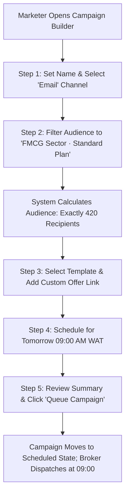

# Product Requirements Document (PRD)
## Sprint 6: Messaging, Campaigns & Trigger Engine

---

### 1. Document Control & Metadata
- **Document Title:** Product Requirements Document - Sprint 6: Messaging, Campaigns & Trigger Engine
- **Document Version:** 1.0.0
- **Status:** In Progress
- **Author:** CICOD Product & Architecture Team
- **Target Sprint:** Sprint 6 (Week 7)
- **Target Audience:** Growth Directors, Lifecycle Marketers, Support Operations Leads, Software Engineers
- **Last Updated:** 2026-10-13

---

### 2. Executive Summary & Core Deliverables
In the legacy platform, campaigns consisted merely of a name and dates with no audience definitions, message bodies, or delivery metrics. The communication template used for overdue invoice dunning erroneously read "Thank you for your order", while email template editors threw HTTP 400 errors. Automated triggers failed to fire, and website newsletter subscribers remained stranded in unworked static tables.

Sprint 6 implements an omnichannel communication engine: a **Shared Communication Template Library** (Email and SMS with dynamic placeholder chips and character counting), an interactive **5-Step Campaign Builder** with live recipient validation, an **Automated Event Trigger Engine** for critical tenant lifecycle milestones, and an actionable **Subscriber Conversion Hub**.

#### Core Deliverables
1. **Shared Template Library (`s6-d1`):** Centralized SMS and Email templates used by both Campaigns and Dunning. *[Tags: Templates, Email/SMS]*
2. **5-Step Campaign Builder (`s6-d2`):** Basics → Audience Segmentation → Message → Schedule → Review & Launch. *[Tags: Campaigns, Segmentation]*
3. **Automated Event Notification Triggers (`s6-d3`):** Bind system events (Trial ending, Payment failed) to communication rules. *[Tags: Triggers, Automation]*

### 3. Product Vision & Strategic Objectives
- **Cohesive Brand Voice:** Eliminate embarrassing template mismatches across billing, onboarding, and promotional touchpoints.
- **Precision Audience Targeting:** Enable marketers to segment audiences by plan tier, sector, and lifecycle health with exact pre-send recipient counts.
- **Hands-Free Lifecycle Engagement:** Automate onboarding welcomes, trial expiration warnings, and failed payment notices without engineering involvement.

---

### 4. Target Audience & User Personas
- **Growth Marketing Manager:** Builds multi-channel broadcast campaigns, creates segmented audiences, and optimizes conversion funnels.
- **Lifecycle Operations Specialist:** Drafts onboarding nurture sequences and ensures transactional notification rules are active.
- **Billing Specialist:** Selects approved, professional SMS and Email templates for automated dunning cadences.

---

### 5. Scope Boundaries

#### 5.1 In-Scope Deliverables
- **Shared Template Library:** Centralized SMS and Email templates used by both Campaigns and Dunning.
- **5-Step Campaign Builder:** Basics → Audience Segmentation → Message → Schedule → Review & Launch.
- **Automated Event Notification Triggers:** Bind system events (Trial ending, Payment failed) to communication rules.

#### 5.2 Out-of-Scope
- Full visual drag-and-drop HTML email WYSIWYG builder (rich text and clean markdown template format utilized for deliverability).
- Custom WhatsApp Business API webhook onboarding (targeted for post-v2 release).
- Telemarketing outbound dialer integration.

---

### 6. Comprehensive User Flow & Journey Maps

#### 6.1 Primary Happy Path Flow


#### 6.2 Alternate & Exception Flows
- **Zero Recipient Block:** Marketer configures a filter combination resulting in 0 matching contacts. In Step 5, the "Launch Campaign" button is disabled with an amber warning: *"Cannot launch campaign: target audience contains 0 recipients"*.
- **High-Risk Template Re-assignment:** User attempts to attach a template with subject "Flash Sale 50% Off" to the `payment.failed` event trigger. System prompts: *"Warning: Selected template is categorized as Marketing. Are you sure you want to use this for transactional payment failure?"*.
- **Subscriber Unsubscribe Processing:** Recipient clicks one-click unsubscribe in email footer. System updates subscriber status to `Unsubscribed` and automatically removes them from active marketing segments.

---

### 7. Functional Requirements (FRs)

#### 7.1 Shared Template Library
- **FR-6.1.1:** Must support multi-channel repository for both Email and SMS, organized by categories: `Billing`, `Marketing`, `Onboarding`, and `Transactional`.
- **FR-6.1.2:** Must provide click-to-insert variable tokens: `{{customer_name}}`, `{{company}}`, `{{subdomain}}`, `{{due_date}}`, `{{amount}}`, `{{payment_link}}`.
- **FR-6.1.3:** SMS editor must render a real-time character counter and segment calculator (160 characters per standard GSM segment).
- **FR-6.1.4:** Must prevent deletion of templates currently linked to active dunning policies or active event triggers.

#### 7.2 5-Step Campaign Builder
- **FR-6.2.1:** Step 1 (Basics): Campaign Name, Objective, and Communication Channel (`Email` or `SMS`).
- **FR-6.2.2:** Step 2 (Audience): Dynamic filtering by Customer Status, Plan Tier, Industry Sector, or Partner Type, rendering real-time recipient counts.
- **FR-6.2.3:** Step 3 (Message): Template picker, subject line, body editor, and responsive mobile/desktop live preview.
- **FR-6.2.4:** Step 4 (Schedule): Immediate dispatch or date/time picker with timezone specification.
- **FR-6.2.5:** Step 5 (Review): Verification checklist and final confirmation modal displaying total recipients and estimated credits.

#### 7.3 Campaign Analytics & Reporting
- **FR-6.3.1:** Dedicated campaign overview page displaying KPI cards: Total Sent, Delivery Rate %, Open Rate %, Click Rate %, and Unsubscribe Rate.
- **FR-6.3.2:** Visual step funnel detailing conversion drops across each delivery milestone.

#### 7.4 Event Notification Triggers
- **FR-6.4.1:** Admin interface for binding triggers: `customer.created`, `trial.ending`, `payment.failed`, and `subscription.suspended`.
- **FR-6.4.2:** Each trigger must support toggle on/off, channel selection, template assignment, and internal staff CC alerts.

#### 7.5 Newsletter Subscribers Desk
- **FR-6.5.1:** Centralized subscriber directory displaying email, signup date, and subscription status.
- **FR-6.5.2:** "Convert to Lead" button creates a pre-populated opportunity in the Growth Pipeline (Sprint 5).

---

### 8. Non-Functional Requirements (NFRs)

#### 8.1 Performance & Latency
- Asynchronous dispatch: Campaign launches must queue to a background job broker (BullMQ/RabbitMQ) within `< 200ms`, never blocking user interface threads.
- Template rendering engine must parse and substitute variable tokens in `< 2ms` per message.

#### 8.2 Security & Compliance
- CAN-SPAM and GDPR Compliance: All outbound emails must include valid organization physical address, sender identity, and one-click unsubscribe links.
- XSS Prevention: Dynamic variables must be strictly HTML-sanitized before injection into email templates.

#### 8.3 Reliability & Availability
- Provider failover: If primary SMS gateway returns 5xx error, dispatch worker must automatically retry via secondary SMS provider.
- Rate limiting: Marketing broadcasts must be throttled to 50 emails/second to protect sender domain reputation.

#### 8.4 Usability & Accessibility
- Live message preview pane must simulate both desktop client and mobile screen sizes.
- Visual token chips must have keyboard focus indicators and tooltips showing sample value.

---

### 9. Detailed User Stories & Sprint Tasks

#### US-6.1 (Deliverable: Shared Template Library): Unified Multichannel Template Authoring
*As a Marketing & Communications Specialist, I want a unified template library for SMS and Email messages with variable placeholder chips and character counters so that marketing campaigns and automated dunning notices share brand-approved, error-free copy.*

- **Acceptance Criteria**:
  - Channel filter for SMS vs Email with variable tags ({{customer_name}}, {{due_date}}).
  - SMS editor calculates exact character count and segment billing (160 chars/SMS).
  - Flags warnings if templates contain invalid or unmapped variable tags.

- **Outlined Sprint Tasks**:
  - [ ] `s6-1` (FRONTEND · L): **Build Template Library with channel filters & usage badges** - *Flag mismatches (e.g. warning when billing dunning uses marketing template).*
  - [ ] `s6-2` (FRONTEND · M): **Implement variable placeholder chips & SMS character counter** - *One-click chip insertion ({{customer_name}}, {{due_date}}) with segment count.*
  - [ ] `s6-6` (FRONTEND · M): **Rich HTML email preview drawer with desktop/mobile switcher** - *Render preview iframe toggling between 375px phone and 600px desktop email views.*

#### US-6.2 (Deliverable: 5-Step Campaign Builder): Targeted Audience Campaign Scheduling
*As a Growth Marketing Lead, I want a 5-step wizard to target audience segments, select templates, schedule delivery, and review performance funnels so that I can launch targeted retention or promo campaigns and measure conversion results.*

- **Acceptance Criteria**:
  - 5 steps: Basics → Audience Query → Message Selection → Schedule → Launch.
  - Real-time estimated recipient count before dispatch.
  - Campaign reporting dashboard displays Sent, Delivered, Opened, and Converted funnels.

- **Outlined Sprint Tasks**:
  - [ ] `s6-3` (FRONTEND · XL): **Build 5-step Campaign Builder wizard** - *Filter audience by customer segment, partner type, or pipeline stage.*
  - [ ] `s6-4` (FRONTEND · M): **Build Campaign Results funnel visualization** - *Sent → Delivered → Opened → Converted metrics with exportable report.*
  - [ ] `s6-7` (BACKEND · L): **Campaign batch dispatch queue worker and throttling logic** - *Backend worker scheduling outbound SMS/Email dispatch through gateway provider.*

#### US-6.3 (Deliverable: Automated Event Notification Triggers): Lifecycle Event Notification Automation
*As a Product Operations Specialist, I want a system trigger console to map lifecycle events (Trial Ending, Invoice Overdue) to automatic communication rules so that critical customer lifecycle events notify merchants automatically without manual staff intervention.*

- **Acceptance Criteria**:
  - Supported triggers: Trial Ending (3 days), Payment Succeeded, Renewal Overdue, Tenant Suspended.
  - Allows toggling triggers on/off and selecting approved template.
  - Execution log records notification dispatch history and delivery receipts.

- **Outlined Sprint Tasks**:
  - [ ] `s6-5` (FRONTEND · M): **Build System Notification Triggers view** - *Toggle automated notifications on/off per event with template selection.*
  - [ ] `s6-8` (BACKEND · L): **Event bus webhook listener triggering message dispatch** - *Subscribe to billing and onboarding domain events to trigger associated templates.*
  - [ ] `s6-9` (BACKEND · M): **Trigger delivery fallback and failure retry handler** - *Automatic secondary channel retry (e.g. SMS fallback on undelivered email).*

### 10. Technical Architecture, Data Models & API Contracts

#### Communication Schemas
```typescript
export interface TemplateDTO {
  id: string;
  name: string;
  category: "BILLING" | "MARKETING" | "ONBOARDING" | "TRANSACTIONAL";
  channel: "EMAIL" | "SMS";
  subject?: string;
  body: string;
  availableTokens: string[];
  isLocked: boolean;
  updatedAt: string;
}

export interface CampaignDTO {
  id: string;
  name: string;
  channel: "EMAIL" | "SMS";
  status: "DRAFT" | "SCHEDULED" | "SENDING" | "COMPLETED" | "CANCELLED";
  audienceFilter: {
    sectors?: string[];
    plans?: string[];
    statuses?: string[];
  };
  totalRecipients: number;
  templateId: string;
  scheduledAt?: string;
  analytics?: {
    sent: number;
    delivered: number;
    opened: number;
    clicked: number;
    unsubscribed: number;
  };
  createdAt: string;
}

export interface TriggerRuleDTO {
  event: "customer.created" | "trial.ending" | "payment.failed" | "subscription.suspended";
  enabled: boolean;
  channel: "EMAIL" | "SMS";
  templateId: string;
  staffCcEmails: string[];
}
```

#### REST API Endpoints
| Method | Endpoint | Description | Status Codes |
|---|---|---|---|
| `GET` | `/api/v2/messaging/templates` | Retrieve shared communication templates | `200` |
| `POST` | `/api/v2/messaging/templates` | Create or update template | `201`, `400` |
| `GET` | `/api/v2/campaigns` | List campaigns with statuses and metrics | `200` |
| `POST` | `/api/v2/campaigns` | Create campaign draft | `201`, `400` |
| `POST` | `/api/v2/campaigns/{id}/launch` | Queue campaign to background broker | `202`, `422` |
| `GET` | `/api/v2/settings/triggers` | Fetch lifecycle event notification bindings | `200` |
| `PATCH` | `/api/v2/settings/triggers/{event}` | Update trigger status and assigned template | `200` |

---

#### REST API Contracts

| Method | Endpoint | Functional Contract & Payload Expectation |
|---|---|---|
| `GET` | `/api/v2/messaging/templates` | List templates with category, channel, and active usage matrix. |
| `POST` | `/api/v2/campaigns` | Creates campaign draft with audience query filters and message body. |
| `POST` | `/api/v2/campaigns/{id}/launch` | Dispatches campaign job to message broker after confirmation. |
| `GET` | `/api/v2/settings/triggers` | Configured event notification bindings. |


---

### 11. Edge Cases & Error Handling Strategies
- **Missing Customer Variable Data:** If a template includes `{{contact_name}}` but the record has no contact name, the engine gracefully falls back to "Valued Customer".
- **SMS Exceeding Maximum Concatenation:** If an SMS body exceeds 612 characters (4 concatenated segments), the editor blocks input and advises switching to email.
- **Recipient Domain Blacklisting:** If a recipient email domain is invalid or on a suppression list, the worker skips the send and flags the contact.

---

### 12. Success Metrics & Key Performance Indicators (KPIs)
- **Zero Template Mismatches:** 100% elimination of promotional copy in billing reminder notifications.
- **Campaign Execution Speed:** Campaigns queued and dispatched within `< 60 seconds` of scheduled time.
- **SMS Cost Efficiency:** 0 wasted credits caused by unmonitored character overflows.
- **Subscriber Conversion:** > 15% of captured website newsletter subscribers converted into qualified sales leads.

---

### 13. Release Plan, Milestones & Definition of Done (DoD)
- **Milestone 6.1 (Days 1–3):** Shared template library with variable token chips and SMS character counting.
- **Milestone 6.2 (Days 4–6):** 5-step campaign builder and live audience estimation engine.
- **Milestone 6.3 (Days 7–8):** Campaign delivery analytics funnel and subscriber conversion desk.
- **Milestone 6.4 (Days 9–10):** System event trigger bindings, background broker queue worker, and integration tests.

---

#### Definition of Done (DoD)
- [ ] Template editor warns if placeholder variable is missing from target trigger payload.
- [ ] Campaign launch is blocked until audience estimation returns > 0 recipients.
- [ ] SMS message preview shows exact segment breakdown (160 characters per SMS).

---

### 14. Architectural Risks, Mitigations & Dependencies

#### Key Architectural Risks & Mitigations
- **Risk & Mitigation:** High SMS provider costs if audience segmentation is too broad.
- **Risk & Mitigation:** Email deliverability/spam flagging if template unsubscription link is omitted.

#### External & Internal Dependencies
- Database schema migrations and tenant isolation verified prior to deployment.
- Google Fonts and Lucide icon assets bundled locally without unauthenticated CDN lock-in.

---

### 15. Open Questions, Decisions & Next Steps

#### Open Architectural Questions & Decisions
- **Question:** What failover exists if the primary SMS gateway experiences downtime?
  - *Decision / Recommendation:* Automatic fallback to secondary SMS provider after 2 consecutive 5xx errors or 3000ms timeout.
- **Question:** How is message rate-limiting enforced across multi-channel campaigns?
  - *Decision / Recommendation:* Token bucket algorithm capping outbound dispatches at 100 msgs/second per merchant account.

#### Next Sprint Handover & Follow-ups
- Verify acceptance criteria and automated tests are green before advancing to Sprint 7 (Administration, RBAC, Keys & Audit Logging).
- Conduct sprint retrospective and synchronize status tokens in roadmap database.

### 16. Test Cases, Use Cases & QA Acceptance Scenarios

| Test ID | Category | Severity | Persona | Title | Expected Outcome |
|---|---|---|---|---|---|
| `TC-6.1` | Happy Path | **Critical** | Lifecycle Marketing Manager | Multi-Channel Triggered Event Message Dispatch | Message engine evaluates dynamic tags ({{customer.name}}, {{invoice.amount}}), compiles template, and dispatches to SMS gateway and Email SMTP in < 250ms. |
| `TC-6.2` | Edge Case | **Critical** | DevOps / SRE | Secondary Provider Fallback on Primary Gateway Timeout | Circuit breaker trips after 2 consecutive timeouts; remaining 48 messages automatically reroute through secondary gateway with zero message drop. |
| `TC-6.3` | Security / RBAC | **High** | Compliance Auditor | Customer Opt-Out & Regulatory Compliance Gate | Campaign audience filter strictly excludes opted-out customer. Excluded count logged in campaign pre-flight summary with reason 'Unsubscribed'. |
| `TC-6.4` | Happy Path | **Medium** | Growth Marketer | Real-Time Campaign Delivery Analytics & Bounce Rate Telemetry | Displays delivered (98.4%), hard bounces (0.8%), soft bounces (0.8%), and open rate (34.2%) with real-time websocket feed. |

#### Detailed Validation Procedures

##### [TC-6.1] Multi-Channel Triggered Event Message Dispatch
- **Category:** Happy Path | **Severity:** Critical | **Persona:** Lifecycle Marketing Manager | **Story:** `US-6.1`
- **Preconditions:** Event rule configured: event: payment.succeeded -> send SMS + Email.
- **Execution Steps:**
  1. Trigger payment.succeeded event webhook.
- **Pass Criteria:** Message engine evaluates dynamic tags ({{customer.name}}, {{invoice.amount}}), compiles template, and dispatches to SMS gateway and Email SMTP in < 250ms.

##### [TC-6.2] Secondary Provider Fallback on Primary Gateway Timeout
- **Category:** Edge Case | **Severity:** Critical | **Persona:** DevOps / SRE | **Story:** `US-6.3`
- **Preconditions:** Primary SMS provider simulated returning HTTP 504 Gateway Timeout.
- **Execution Steps:**
  1. Dispatch outbound campaign batch of 50 messages.
- **Pass Criteria:** Circuit breaker trips after 2 consecutive timeouts; remaining 48 messages automatically reroute through secondary gateway with zero message drop.

##### [TC-6.3] Customer Opt-Out & Regulatory Compliance Gate
- **Category:** Security / RBAC | **Severity:** High | **Persona:** Compliance Auditor | **Story:** `US-6.2`
- **Preconditions:** Customer has opted out of marketing communications (marketing_opt_in: false).
- **Execution Steps:**
  1. Marketing manager launches promotional broadcast campaign.
- **Pass Criteria:** Campaign audience filter strictly excludes opted-out customer. Excluded count logged in campaign pre-flight summary with reason 'Unsubscribed'.

##### [TC-6.4] Real-Time Campaign Delivery Analytics & Bounce Rate Telemetry
- **Category:** Happy Path | **Severity:** Medium | **Persona:** Growth Marketer | **Story:** `US-6.4`
- **Preconditions:** Campaign dispatched to 5,000 contacts.
- **Execution Steps:**
  1. Open Campaign Telemetry view.
  2. Observe live progress ring.
- **Pass Criteria:** Displays delivered (98.4%), hard bounces (0.8%), soft bounces (0.8%), and open rate (34.2%) with real-time websocket feed.

