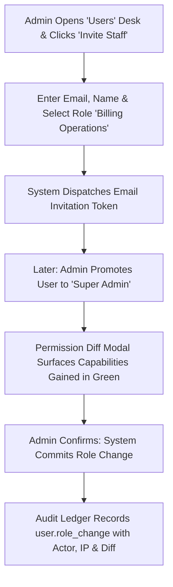

# Product Requirements Document (PRD)
## Sprint 7: Administration, RBAC, Keys & Audit Logging

---

### 1. Document Control & Metadata
- **Document Title:** Product Requirements Document - Sprint 7: Administration, RBAC, Keys & Audit Logging
- **Document Version:** 1.0.0
- **Status:** In Progress
- **Author:** CICOD Product & Architecture Team
- **Target Sprint:** Sprint 7 (Week 8)
- **Target Audience:** Chief Information Security Officer (CISO), Compliance Officers, System Administrators, Security Engineers
- **Last Updated:** 2026-10-13

---

### 2. Executive Summary & Core Deliverables
The legacy application suffered catastrophic governance vulnerabilities: 68 out of 70 staff members held unchecked "ADMIN" privileges, 58 accounts had been inactive for over 90 days with no deactivation mechanism, and user deletion was a permanent one-click risk. API keys were generated by typing arbitrary IDs into unauthenticated inputs and displayed in plain text without expiration or hash verification. Finally, live database connection strings were exposed in the front-end UI, and no centralized audit trail existed.

Sprint 7 delivers enterprise-grade security and administrative governance: granular **Role-Based Access Control (RBAC)**, safe **User Management** with a 90+ day stale account review, a secure **Merchant API Key Lifecycle** (hashed secrets shown once), and an immutable, append-only **System Audit Trail**.

#### Core Deliverables
1. **User Management & Role Assignment (`s7-d1`):** Active, Invited, Inactive 90+ days, Deactivated. Role change impact diff modal. *[Tags: Users, RBAC]*
2. **Role & Permission Matrix (`s7-d2`):** Granular access configuration for Admin, Billing Ops, Sales Rep, Support, Viewer. *[Tags: Permissions, Security]*
3. **Merchant API Key Lifecycle (`s7-d3`):** Select merchant, generate key shown once with copy CTA, store masked, revoke with reason. *[Tags: API Keys, Security]*
4. **System Audit Log & Compliance Export (`s7-d4`):** Immutable record of Actor, Event, Entity, Diff, and Timestamp with CSV download. *[Tags: Audit Log, Compliance]*

### 3. Product Vision & Strategic Objectives
- **Least-Privilege Enforcement:** Ensure staff members hold only the minimum necessary operational permissions required for their daily duties.
- **Credential Hygiene:** Eliminate unhashed API tokens and stale, unmonitored employee logins across the platform.
- **Forensic Traceability:** Maintain an immutable record of every critical system modification (price changes, suspensions, role reassignments).

---

### 4. Target Audience & User Personas
- **Chief Information Security Officer (CISO):** Audits administrative privilege distribution, monitors inactive users, and inspects credential lifecycles.
- **Compliance & Risk Auditor:** Queries historical change logs to verify regulatory compliance (NDPR, ISO 27001, SOC 2).
- **System Administrator:** Onboards new staff via email invitations, assigns roles, and rotates compromised integration keys.

---

### 5. Scope Boundaries

#### 5.1 In-Scope Deliverables
- **User Management & Role Assignment:** Active, Invited, Inactive 90+ days, Deactivated. Role change impact diff modal.
- **Role & Permission Matrix:** Granular access configuration for Admin, Billing Ops, Sales Rep, Support, Viewer.
- **Merchant API Key Lifecycle:** Select merchant, generate key shown once with copy CTA, store masked, revoke with reason.
- **System Audit Log & Compliance Export:** Immutable record of Actor, Event, Entity, Diff, and Timestamp with CSV download.

#### 5.2 Out-of-Scope
- Hardware security key (YubiKey / WebAuthn FIDO2) registration (scheduled for post-v2).
- Single Sign-On (SSO) SAML / Okta enterprise federations (mocked token flows in Sprint 7).
- Direct production database provisioning from UI (permanently removed for security).

---

### 6. Comprehensive User Flow & Journey Maps

#### 6.1 Primary Happy Path Flow


#### 6.2 Alternate & Exception Flows
- **Self-Deactivation Block:** A logged-in administrator attempts to click "Deactivate" on their own profile row. System disables the button and displays a warning tooltip: *"You cannot deactivate your own active session. Contact another administrator."*
- **Stale Account Review:** Security admin switches to "Not signed in 90+ days" tab. Selects 12 inactive accounts and clicks "Deactivate Stale Users". Accounts are soft-deactivated and their session tokens immediately invalidated.
- **Key Secret Dismissal:** Operator generates a new API key. Secret `ck_live_9a...` appears in a modal with warning: *"This token will never be shown again"*. Once closed, secret is permanently hidden and displayed as `••••ABCD`.

---

### 7. Functional Requirements (FRs)

#### 7.1 User Management & Stale Account Review
- **FR-7.1.1:** Must provide user segment tabs: *Active*, *Not signed in 90+ days*, *Invited*, and *Deactivated*.
- **FR-7.1.2:** "Invite User" modal must capture Work Email, Full Name, and Assigned Role, generating a secure token with 7-day expiration.
- **FR-7.1.3:** Changing a user's role must open a Permission Diff Modal showing added permissions (green) and removed permissions (red).
- **FR-7.1.4:** Deactivation must require a documented reason code ("Resigned", "Role change", "Suspicious activity") and block self-deactivation.

#### 7.2 Roles & Permissions Matrix
- **FR-7.2.1:** Must support standard built-in roles: `Super Admin`, `Billing Operations`, `Sales Representative`, `Support Agent`, and `Read-Only Viewer`.
- **FR-7.2.2:** Permissions matrix must control scopes across Modules: Customers, Billing, Catalogue, Growth, Messaging, and Settings.
- **FR-7.2.3:** Action verbs per module must include: `VIEW`, `CREATE`, `EDIT`, `SUSPEND_PUBLISH`, and `EXPORT`.

#### 7.3 Merchant API Key Lifecycle
- **FR-7.3.1:** Key generation must bind to a specific Merchant ID, descriptive label, and permission scope.
- **FR-7.3.2:** Plaintext secret must be generated via cryptographically secure random bytes, shown only once in modal, and saved as a SHA-256 hash.
- **FR-7.3.3:** Key directory must show masked key (`••••ABCD`), Creator, Created Date, Last Used timestamp, and Revoke action.
- **FR-7.3.4:** Revocation must immediately invalidate key authorization and record actor reason.

#### 7.4 System Audit Trail
- **FR-7.4.1:** Append-only table logging Timestamp (UTC), Actor (Name, Email, IP), Action Type, Target Entity, and Payload Diff.
- **FR-7.4.2:** Clicking an audit row must expand a visual JSON diff showing before-and-after attributes.
- **FR-7.4.3:** "Export Audit Log (CSV)" must generate a formatted compliance download matching active filters.

---

### 8. Non-Functional Requirements (NFRs)

#### 8.1 Performance & Latency
- Permission check middleware must evaluate staff capability tokens in `< 1ms` in memory.
- Audit table queries across 100,000+ historical events must return in `< 250ms` using indexed timestamps.

#### 8.2 Security & Compliance
- Cryptographic Hashing: API keys and passwords must use industry-standard hashing (SHA-256 for API tokens, bcrypt with work factor 12 for passwords).
- Append-Only Database Policy: The audit table connection must have revoked `UPDATE` and `DELETE` SQL permissions.

#### 8.3 Reliability & Availability
- Audit logging failures must not silently fail; critical security events must fail closed or trigger emergency log alerts.
- Stale account cron must run daily at 00:00 UTC without service interruption.

#### 8.4 Usability & Accessibility
- Permission diff modal must use clear symbols (+ and -) alongside colors for color-blind accessibility.
- Masked key strings must feature one-click copy buttons for convenient developer sharing.

---

### 9. Detailed User Stories & Sprint Tasks

#### US-7.1 (Deliverable: User Management & Role Assignment): Staff User Directory & Least-Privilege Role Assignment
*As a Enterprise IT Security Manager, I want a staff user directory with active status tabs, 90-day inactive review, and role change diff confirmation so that I can enforce the principle of least privilege and eliminate dormant staff accounts.*

- **Acceptance Criteria**:
  - Tabs: Active, Invited, Inactive 90+ days, Deactivated.
  - Role change modal displays visual diff of gained/revoked permissions before saving.
  - Self-deactivation is strictly prohibited.

- **Outlined Sprint Tasks**:
  - [ ] `s7-1` (FRONTEND · M): **Build Users list with status tabs & stale user review** - *Highlight staff not logged in for 90+ days; provide soft deactivation.*
  - [ ] `s7-2` (FRONTEND · M): **Implement 'Change Role' dialog with permission diff** - *Clearly show what capabilities the user gains or loses before saving.*
  - [ ] `s7-7` (BACKEND · S): **Automated stale user detection and notification job** - *Cron flag marking inactive staff accounts for quarterly access recertification.*

#### US-7.2 (Deliverable: Role & Permission Matrix): Granular Role & Permission Access Control Matrix
*As a Compliance Officer, I want a granular Roles & Permissions matrix editor to define Create, Read, Update, Delete access per CRM module so that staff access is restricted strictly to their job function without universal Super Admin access.*

- **Acceptance Criteria**:
  - Preconfigured roles: Super Admin, Billing Ops, Sales Rep, Customer Support, Read-Only Viewer.
  - Matrix controls access across Customers, Catalogue, Billing, Growth, and Settings.
  - Custom role creation validates that at least one system admin role is preserved.

- **Outlined Sprint Tasks**:
  - [ ] `s7-3` (FRONTEND · L): **Build Roles & Permissions matrix editor** - *Tabular matrix of areas (Customers, Billing, Catalogue) vs CRUD permissions.*
  - [ ] `s7-6` (BACKEND · XL): **Implement centralized Audit Interceptor & RBAC middleware** - *Backend middleware enforcing permission tokens and appending audit rows.*
  - [ ] `s7-8` (QA · S): **RBAC authorization matrix unit test suite** - *Verify route access blocks for non-permitted roles across 25 endpoints.*

#### US-7.3 (Deliverable: Merchant API Key Lifecycle): Secure Developer API Key Generation & Masking
*As a Platform Integration Engineer, I want a secure API key generator for merchant integrations with one-time reveal modal and masked storage so that developers can integrate with CICOD CRM APIs without plaintext secrets leaking in databases.*

- **Acceptance Criteria**:
  - Generates cryptographically secure API keys displayed in full only once.
  - Stored and displayed as masked strings (••••••••ABCD) on subsequent views.
  - Revocation modal requires mandatory reason code and immediately invalidates bearer tokens.

- **Outlined Sprint Tasks**:
  - [ ] `s7-4` (FRONTEND · M): **Build Merchant API Key generator with one-time view modal** - *Display full secret once; list keys masked (••••ABCD) with revoke modal.*
  - [ ] `s7-9` (BACKEND · M): **API key hashing, encryption at rest, and instant token revocation** - *HMAC hashing and database storage of merchant API keys with revocation check.*
  - [ ] `s7-10` (QA · S): **API Key authentication middleware and rate-limiting tests** - *Test bearer token validation and 100 req/min rate limits per merchant.*

#### US-7.4 (Deliverable: System Audit Log & Compliance Export): Immutable Audit Trail & Regulatory CSV Export
*As a Security Auditor, I want an immutable, tamper-evident System Audit Log recording every sensitive mutation with before/after diffs so that our organization complies with regulatory standards and can audit unauthorized data modifications.*

- **Acceptance Criteria**:
  - Captures Actor, Event, Entity ID, IP address, Timestamp, and before/after JSON diff.
  - Filter by date range, actor, entity type, and severity.
  - Export to CSV/JSON for external compliance audits.

- **Outlined Sprint Tasks**:
  - [ ] `s7-5` (FRONTEND · L): **Build System Audit Log table with filter & CSV export** - *Queryable timeline of system changes with expandable JSON payload diffs.*
  - [ ] `s7-11` (FRONTEND · S): **Expandable JSON payload diff visualizer for audit rows** - *Visual comparison of modified database records highlighting changed fields.*
  - [ ] `s7-12` (BACKEND · M): **Immutable append-only audit log database table and indexing** - *High-volume partition indexing ensuring fast audit retrieval by actor and date.*

### 10. Technical Architecture, Data Models & API Contracts

#### Governance Schemas
```typescript
export interface UserDTO {
  id: string;
  name: string;
  email: string;
  roleId: string;
  roleName: string;
  status: "ACTIVE" | "STALE_90D" | "INVITED" | "DEACTIVATED";
  lastLoginAt?: string;
  createdAt: string;
}

export interface RoleWithPermissionsDTO {
  id: string;
  name: string;
  description: string;
  isSystemLocked: boolean;
  permissions: Array<{
    module: "CUSTOMERS" | "BILLING" | "CATALOGUE" | "GROWTH" | "SETTINGS";
    actions: Array<"VIEW" | "CREATE" | "EDIT" | "SUSPEND_PUBLISH" | "EXPORT">;
  }>;
}

export interface ApiKeyDTO {
  id: string;
  merchantId: string;
  merchantName: string;
  label: string;
  maskedKey: string; // e.g. "••••992A"
  scope: "READ_ONLY" | "TRANSACTIONS" | "FULL_ACCESS";
  status: "ACTIVE" | "REVOKED";
  createdBy: string;
  createdAt: string;
  lastUsedAt?: string;
}

export interface AuditLogEntryDTO {
  id: string;
  timestamp: string;
  actor: {
    id: string;
    name: string;
    email: string;
    ipAddress: string;
  };
  action: string; // e.g. "customer.suspend", "plan.publish"
  targetEntity: {
    type: string;
    id: string;
    label: string;
  };
  diff?: {
    before: Record<string, unknown>;
    after: Record<string, unknown>;
  };
}
```

#### REST API Endpoints
| Method | Endpoint | Description | Status Codes |
|---|---|---|---|
| `GET` | `/api/v2/users` | List staff with login metadata and status | `200` |
| `POST` | `/api/v2/users/invite` | Send staff invitation email | `201`, `400` |
| `PATCH` | `/api/v2/users/{id}/role` | Update role with diff logging | `200`, `403` |
| `POST` | `/api/v2/users/{id}/deactivate` | Soft-deactivate staff account | `200`, `422` |
| `GET` | `/api/v2/roles` | Retrieve role permissions matrix | `200` |
| `POST` | `/api/v2/api-keys` | Generate scoped API key (returns secret once) | `201` |
| `POST` | `/api/v2/api-keys/{id}/revoke` | Revoke active merchant API key | `200` |
| `GET` | `/api/v2/audit-log` | Query immutable audit log records | `200` |
| `GET` | `/api/v2/audit-log/export` | Download audit entries as CSV | `200` |

---

#### REST API Contracts

| Method | Endpoint | Functional Contract & Payload Expectation |
|---|---|---|
| `GET` | `/api/v2/users` | Staff directory with assigned role and last login timestamp. |
| `PATCH` | `/api/v2/users/{id}/role` | Updates user role; logs actor and reason to audit log. |
| `POST` | `/api/v2/api-keys` | Generates hashed key; returns plain secret once in response. |
| `GET` | `/api/v2/audit-log` | Queryable audit log with entity filter and date range. |


---

### 11. Edge Cases & Error Handling Strategies
- **Attempted Self-Deactivation:** System rejects the API call with HTTP 422: *"Cannot deactivate current authenticated user"*.
- **Revoking Key with Active Traffic:** System alerts operator: *"This key handled 1,420 calls in the last 24 hours. Revoking will immediately reject further requests."*
- **Role Deletion While Assigned:** Deleting a custom role is blocked if any active staff member is currently assigned to it.

---

### 12. Success Metrics & Key Performance Indicators (KPIs)
- **Privilege Normalization:** 100% of non-admin staff migrated away from unrestricted "ADMIN" roles.
- **Stale Account Elimination:** 0 active accounts with no login activity in > 90 days.
- **Zero Raw Secret Breaches:** 100% of integration credentials hashed with salt at rest.
- **Audit Completeness:** 100% of administrative mutations accompanied by tamper-proof audit log entries.

---

### 13. Release Plan, Milestones & Definition of Done (DoD)
- **Milestone 7.1 (Days 1–3):** User management desk with status segments, invite modal, and stale account filters.
- **Milestone 7.2 (Days 4–5):** Roles and permissions matrix with Permission Diff confirmation dialog.
- **Milestone 7.3 (Days 6–7):** Secure API Key generator with one-time display modal and revocation controls.
- **Milestone 7.4 (Days 8–10):** Append-only audit log viewer with JSON diff inspector and CSV exporter.

---

#### Definition of Done (DoD)
- [ ] Staff cannot deactivate their own user account.
- [ ] API keys cannot be revealed a second time after initial creation modal closes.
- [ ] All sensitive mutations produce an audit log entry.

---

### 14. Architectural Risks, Mitigations & Dependencies

#### Key Architectural Risks & Mitigations
- **Risk & Mitigation:** Locking out administrators if default Super Admin permissions are accidentally edited.
- **Risk & Mitigation:** High volume audit logging impacting database write throughput.

#### External & Internal Dependencies
- Database schema migrations and tenant isolation verified prior to deployment.
- Google Fonts and Lucide icon assets bundled locally without unauthenticated CDN lock-in.

---

### 15. Open Questions, Decisions & Next Steps

#### Open Architectural Questions & Decisions
- **Question:** How long are immutable audit logs retained?
  - *Decision / Recommendation:* 7 years retention in append-only storage with SHA-256 tamper-evident integrity hashes.
- **Question:** How are sensitive API keys and client secrets presented upon creation?
  - *Decision / Recommendation:* Full key secret displayed exactly once upon generation; subsequent views only display masked prefix ck_live_... .

#### Next Sprint Handover & Follow-ups
- Verify acceptance criteria and automated tests are green before advancing to Sprint 8 (Backend Integration, QA & Production Launch).
- Conduct sprint retrospective and synchronize status tokens in roadmap database.

### 16. Test Cases, Use Cases & QA Acceptance Scenarios

| Test ID | Category | Severity | Persona | Title | Expected Outcome |
|---|---|---|---|---|---|
| `TC-7.1` | Security / RBAC | **Critical** | Security Officer | Granular RBAC Permission Matrix Enforcement | Route guard intercepts navigation and displays 403 Forbidden tile. Sidebar hides Administration menu entirely. API requests to /api/v2/admin/roles return HTTP 403. |
| `TC-7.2` | Security / RBAC | **Critical** | Developer / Integrator | Live API Key Generation & One-Time Secret Reveal | Full secret (e.g. ck_live_8f92a1...) displayed inside focus-trapped dialog with 'Copy to Clipboard' CTA and warning. Subsequent list views display only masked prefix ck_live_8f92...••••. |
| `TC-7.3` | Security / RBAC | **Critical** | Compliance Auditor | Tamper-Evident Immutable Audit Log Integrity | Log entry captures Actor ID, IP Address, User Agent, Timestamp (UTC), Action (USER_SUSPEND), Target ID, and reason note. Audit log rows cannot be edited or deleted by any user or administrator. |
| `TC-7.4` | Security / RBAC | **High** | System Administrator | Multi-Factor Authentication (2FA) TOTP Enforcement on Admin Login | Login halted at 6-digit TOTP verification screen. Session token is not issued until valid authenticator code is entered; 3 failed attempts locks login for 15 minutes. |

#### Detailed Validation Procedures

##### [TC-7.1] Granular RBAC Permission Matrix Enforcement
- **Category:** Security / RBAC | **Severity:** Critical | **Persona:** Security Officer | **Story:** `US-7.1`
- **Preconditions:** User account assigned 'Billing Specialist' role (lacks users:manage and settings:edit).
- **Execution Steps:**
  1. User logs in.
  2. User attempts to browse directly to /crm/settings/rbac.
- **Pass Criteria:** Route guard intercepts navigation and displays 403 Forbidden tile. Sidebar hides Administration menu entirely. API requests to /api/v2/admin/roles return HTTP 403.

##### [TC-7.2] Live API Key Generation & One-Time Secret Reveal
- **Category:** Security / RBAC | **Severity:** Critical | **Persona:** Developer / Integrator | **Story:** `US-7.2`
- **Preconditions:** Admin opening /crm/settings/apikeys.
- **Execution Steps:**
  1. Click 'Generate API Key'.
  2. Enter key label and scopes.
  3. Observe secret modal.
  4. Close modal and refresh page.
- **Pass Criteria:** Full secret (e.g. ck_live_8f92a1...) displayed inside focus-trapped dialog with 'Copy to Clipboard' CTA and warning. Subsequent list views display only masked prefix ck_live_8f92...••••.

##### [TC-7.3] Tamper-Evident Immutable Audit Log Integrity
- **Category:** Security / RBAC | **Severity:** Critical | **Persona:** Compliance Auditor | **Story:** `US-7.3`
- **Preconditions:** Tenant state change executed (user suspended).
- **Execution Steps:**
  1. Open Audit Log table.
  2. Verify log record details.
- **Pass Criteria:** Log entry captures Actor ID, IP Address, User Agent, Timestamp (UTC), Action (USER_SUSPEND), Target ID, and reason note. Audit log rows cannot be edited or deleted by any user or administrator.

##### [TC-7.4] Multi-Factor Authentication (2FA) TOTP Enforcement on Admin Login
- **Category:** Security / RBAC | **Severity:** High | **Persona:** System Administrator | **Story:** `US-7.4`
- **Preconditions:** Tenant policy enforces mandatory 2FA for Super Admin role.
- **Execution Steps:**
  1. Super Admin enters username and password.
  2. Observe 2FA challenge screen.
- **Pass Criteria:** Login halted at 6-digit TOTP verification screen. Session token is not issued until valid authenticator code is entered; 3 failed attempts locks login for 15 minutes.

