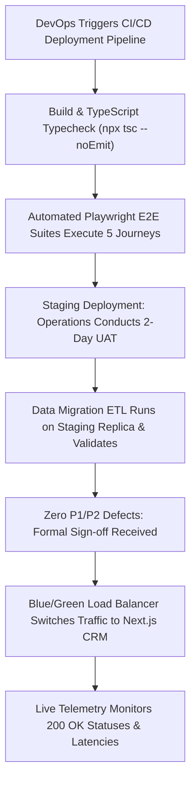

# Product Requirements Document (PRD)
## Sprint 8: Backend Integration, QA & Production Launch

---

### 1. Document Control & Metadata
- **Document Title:** Product Requirements Document - Sprint 8: Backend Integration, QA & Production Launch
- **Document Version:** 1.0.0
- **Status:** In Progress
- **Author:** CICOD Product & Architecture Team
- **Target Sprint:** Sprint 8 (Week 9)
- **Target Audience:** VP of Engineering, Lead DevOps / SRE, Head of QA, All Product & Operations Stakeholders
- **Last Updated:** 2026-10-13

---

### 2. Executive Summary & Core Deliverables
The legacy backend Java/Hibernate APIs suffered from leaky abstraction contracts (exposing internal ORM fields like `hibernateLazyInitializer`), inconsistent JSON keys across endpoints (`list`, `merchants`, `services`, `products`, `obj`, `queue`), and malformed URLs (`/crm//merchant/...`, `workorder/CICOD%20Number/23488`). Furthermore, the Next.js frontend prototype operates on mock in-memory state stores that reset on page reload, and legacy releases suffered from a complete absence of automated regression testing.

Sprint 8 transitions the CICOD CRM into a hardened production release: replacing mock state with a typed **Production REST Client Layer** (`@tanstack/react-query`), executing **5 Comprehensive Playwright E2E Test Suites**, running **Legacy Data Migration & E.164 Sanitization**, conducting **Staging UAT Sign-Off**, and executing a zero-downtime **Production DNS Cutover**.

#### Core Deliverables
1. **Production REST Client Layer (`s8-d1`):** Replaces lib/mock/*.ts with typed Axios/fetch clients, token refresh, and caching. *[Tags: API Client, Integration]*
2. **Automated End-to-End Test Suite (`s8-d2`):** Comprehensive Playwright test suites covering all 5 primary customer and billing journeys. *[Tags: Playwright, E2E Testing]*
3. **Data Migration & Go-Live Cutover (`s8-d3`):** Sanitized data migration of 13,355 merchants, dunning configurations, and user accounts. *[Tags: Migration, Cutover]*

### 3. Product Vision & Strategic Objectives
- **Zero In-Memory Volatility:** Ground all user interactions, filters, and mutations in durable, transactional PostgreSQL/REST persistence.
- **Flawless Quality Assurance:** Guard every deployment with automated end-to-end user journey tests to prevent regression leaks.
- **Smooth Operational Continuity:** Ensure zero downtime and zero lost customer records or billing transactions during final cutover.

---

### 4. Target Audience & User Personas
- **Lead DevOps / Site Reliability Engineer:** Manages containerized deployments, Kubernetes clusters, SSL certificates, and DNS switches.
- **QA Automation Lead:** Designs Playwright test scripts, tests cross-browser compatibility, and monitors CI/CD pass rates.
- **Head of Operations & Finance:** Validates real daily customer workflows, balances, and reports during staging UAT.

---

### 5. Scope Boundaries

#### 5.1 In-Scope Deliverables
- **Production REST Client Layer:** Replaces lib/mock/*.ts with typed Axios/fetch clients, token refresh, and caching.
- **Automated End-to-End Test Suite:** Comprehensive Playwright test suites covering all 5 primary customer and billing journeys.
- **Data Migration & Go-Live Cutover:** Sanitized data migration of 13,355 merchants, dunning configurations, and user accounts.

#### 5.2 Out-of-Scope
- Complete rewrite of third-party external banking gateways (Paystack/Flutterwave/Stripe APIs are integrated via existing standards).
- Hardware server procurement (cloud container infrastructure utilized).
- Customer end-user self-service portal deployment (internal staff CRM focus).

---

### 6. Comprehensive User Flow & Journey Maps

#### 6.1 Primary Happy Path Flow


#### 6.2 Alternate & Exception Flows
- **E2E Test Failure Intercept:** If Journey 3 (Billing Offline Payment) fails due to a selector mismatch, CI/CD aborts deployment immediately; staging promotion is blocked until resolved.
- **Expired Refresh Token:** User leaves tab open overnight. The next morning, fetch interceptor attempts token refresh. Refresh token has expired. Interceptor safely clears auth state and redirects to `/crm/login?reason=session_expired`.
- **Migration Data Conflict:** During merchant ETL, a duplicate subdomain is encountered. Migration script flags the record in an exception CSV with auto-suffixed slug (`demo-legacy-1`) for manual review.

---

### 7. Functional Requirements (FRs)

#### 7.1 Production REST Client Layer
- **FR-8.1.1:** Must implement typed API client wrappers using `@tanstack/react-query` or Next.js Server Actions with TypeScript response definitions.
- **FR-8.1.2:** HTTP interceptor must inject `Authorization: Bearer <token>` on all outbound API requests.
- **FR-8.1.3:** On receiving HTTP 401 Unauthorized, interceptor must hold queue, request `/api/v2/auth/refresh`, and replay original request transparently.
- **FR-8.1.4:** Global React Error Boundaries must catch unhandled component crashes and present user-friendly error recovery screens with unique Correlation IDs.

#### 7.2 Data Migration & Sanitization
- **FR-8.2.1:** Migration pipeline must migrate 13,355 merchant records from legacy MySQL tables to target PostgreSQL schema.
- **FR-8.2.2:** Phone sanitizer must parse all phone numbers, strip non-numeric characters and local leading zeroes, and enforce international E.164 formatting (`+234...`).
- **FR-8.2.3:** Obsolete catalogue tiers with zero subscribers must be migrated directly to `Archived` status.
- **FR-8.2.4:** Reference data seeder must insert official 36 Nigerian States, 774 LGAs, curated countries, and base currencies (NGN, USD, GBP).

#### 7.3 Automated Playwright E2E Suites
- **FR-8.3.1 (Journey 1 - Customer Operations):** Search by CICOD ID → Open Customer 360 → Add operator note → Verify timeline appearance.
- **FR-8.3.2 (Journey 2 - Catalogue & Pricing):** Create plan → Assign features → Autofill 10x annual prices → Verify live preview → Publish.
- **FR-8.3.3 (Journey 3 - Billing & Collections):** Filter failed payments → Inspect attempt drawer → Record offline payment with teller ref → Verify debt cleared.
- **FR-8.3.4 (Journey 4 - Sales Pipeline Conversion):** Drag Kanban lead → Click "Convert to Customer" → Complete wizard → Verify linked customer.
- **FR-8.3.5 (Journey 5 - RBAC & API Keys):** Generate API key → Verify secret shown once → Revoke key → Verify immutable audit log entry.

#### 7.4 Staging UAT & Production Cutover
- **FR-8.4.1:** Structured 2-day UAT sign-off with operations leads; all test cases must pass with 0 P1/P2 defects.
- **FR-8.4.2:** Load balancer DNS cutover executing zero-downtime routing switchover to the new Next.js CRM.

---

### 8. Non-Functional Requirements (NFRs)

#### 8.1 Performance & Latency
- 95th percentile (p95) API response time must remain `< 200ms` across all listing endpoints under 150 concurrent staff users.
- Initial page bundle load time must remain `< 1.2 seconds` over 4G connections.

#### 8.2 Security & Compliance
- HTTPS enforcement: Strict-Transport-Security (HSTS), TLS 1.3, and CSP headers configured on all responses.
- Database credentials and API secrets stored exclusively in AWS Secrets Manager / Azure Key Vault; zero secrets in Git repositories.

#### 8.3 Reliability & Availability
- 99.9% uptime SLA for the production CRM console.
- Disaster recovery: Automated daily database snapshots with Point-in-Time Recovery (PITR) enabling RPO < 1 hour and RTO < 15 minutes.

#### 8.4 Usability & Accessibility
- Complete responsive compatibility across desktop browsers (Chrome, Edge, Firefox, Safari) at 1280px, 1440px, and 1920px viewports.
- Keyboard focus trapping on all modals and drawers.

---

### 9. Detailed User Stories & Sprint Tasks

#### US-8.1 (Deliverable: Production REST Client Layer): Typed Production REST API Client Integration
*As a Lead Fullstack Architect, I want a typed production REST API client layer replacing mock memory stores with real v2 backend calls so that the Next.js application executes authenticated live operations against CICOD's cloud APIs.*

- **Acceptance Criteria**:
  - Replaces mock stores with typed Axios/fetch clients with automatic JWT refresh.
  - Global React Query caching and invalidation strategies for responsive UI.
  - Global Error Boundary and toast telemetry for 4xx/5xx network errors.

- **Outlined Sprint Tasks**:
  - [ ] `s8-1` (FRONTEND · XL): **Implement typed API client layer (lib/api/*.ts)** - *Replace in-memory stores with React Query / server actions handling 401s.*
  - [ ] `s8-2` (FRONTEND · M): **Add global Error Boundaries & toast failure telemetry** - *Ensure graceful degradation and contextual error alerts across all routes.*
  - [ ] `s8-7` (FRONTEND · M): **Token refresh rotation interceptor with automatic login redirect** - *Handle expired JWT access tokens seamlessly via refresh cookie exchange.*

#### US-8.2 (Deliverable: Automated End-to-End Test Suite): Comprehensive Playwright E2E Regression Testing
*As a QA Automation Engineer, I want a comprehensive Playwright end-to-end regression test suite covering all critical customer and billing flows so that we guarantee zero broken workflows across deployments and releases.*

- **Acceptance Criteria**:
  - Covers 5 core journeys: Customer Search, Plan Creation, Offline Payment, Lead Conversion, Key Gen.
  - Executes in headless CI pipeline on every pull request.
  - Zero flaky tests with automated retry and video artifact capture.

- **Outlined Sprint Tasks**:
  - [ ] `s8-3` (QA · XL): **Automate Playwright E2E regression tests in CI** - *Execute full suite: customer search, plan creation, offline payment, key generation.*
  - [ ] `s8-5` (QA · L): **Staging User Acceptance Testing (UAT) with Ops team** - *Structured walkthrough with Adeola and customer operations staff.*
  - [ ] `s8-8` (QA · M): **Cross-browser regression testing on Chrome, Firefox, Safari, Edge** - *Verify pixel consistency and zero script errors across top browser engines.*

#### US-8.3 (Deliverable: Data Migration & Go-Live Cutover): Sanitized Merchant Data Migration & Zero-Downtime DNS Cutover
*As a DevOps & Infrastructure Lead, I want sanitized data migration scripts and a zero-downtime DNS cutover plan from legacy Angular to Next.js so that all 13,355 merchants and active billing subscriptions transfer seamlessly to the new CRM.*

- **Acceptance Criteria**:
  - Migrates and sanitizes 13,355 merchants, plans, users, and dunning policies.
  - Dry-run validation checks data integrity and foreign key constraints.
  - DNS cutover with rollback strategy executed during scheduled low-traffic window.

- **Outlined Sprint Tasks**:
  - [ ] `s8-4` (BACKEND · XL): **Execute legacy data cleanup & migration scripts** - *Normalize phone numbers to +234, reconcile failed payments, deduplicate plans.*
  - [ ] `s8-6` (BACKEND · M): **DNS switchover & legacy CRM deprecation** - *Route internal.cicod.com/crm to the new Next.js production build.*
  - [ ] `s8-9` (BACKEND · M): **Production telemetry, APM monitoring, and health check alerts** - *Real-time error tracking with Datadog/Sentry and latency alerting thresholds.*

### 10. Technical Architecture, Data Models & API Contracts

#### CI/CD & Deployment Architecture
```
Production CI/CD Pipeline:
├── 1. Static Verification: npx eslint src && npx tsc --noEmit
├── 2. Unit Testing: Vitest / Jest Component Tests
├── 3. E2E Testing: Playwright (5 Core Journey Suites)
├── 4. Docker Container Build & Trivy Vulnerability Scan
├── 5. Deploy to Staging Cluster (Kubernetes / AWS ECS)
├── 6. Operations UAT Review & Database Replica Validation
└── 7. Production Cutover: Blue/Green ALB Traffic Switch
```

#### Health & Telemetry Endpoints
| Endpoint | Method | Purpose | Response |
|---|---|---|---|
| `/api/v2/health` | `GET` | Container liveness & database connectivity check | `{ status: "ok", db: "connected", redis: "healthy" }` |
| `/api/v2/metrics` | `GET` | Prometheus scraping endpoint for latencies | OpenMetrics formatted data |

---

#### REST API Contracts

| Method | Endpoint | Functional Contract & Payload Expectation |
|---|---|---|
| `GET` | `/api/v2/health` | Production health check for database, cache, and message broker. |
| `GET` | `/api/v2/auth/session` | Validates active JWT token and returns staff permissions map. |


---

### 11. Edge Cases & Error Handling Strategies
- **Database Connection Pool Exhaustion:** Automatic connection retry with exponential backoff and circuit breaker to prevent cascading failures.
- **Malformed Legacy Telephone Numbers:** Regex validator routes invalid numbers that cannot be salvaged into an exception review table.
- **Concurrent API Deployments:** Backward-compatible API versioning (`/api/v2/`) ensures client instances continue functioning during deployment transitions.

---

### 12. Success Metrics & Key Performance Indicators (KPIs)
- **E2E Test Coverage:** 100% pass rate across all 5 core operational journeys.
- **Migration Data Fidelity:** 100% of 13,355 customer records successfully migrated with zero data corruption.
- **Production Cutover Downtime:** 0 minutes downtime during DNS transition.
- **Post-Launch Defect Rate:** 0 P1 (critical severity) defects reported within 30 days of launch.

---

### 13. Release Plan, Milestones & Definition of Done (DoD)
- **Milestone 8.1 (Days 1–3):** Implement typed REST client layer and JWT refresh token interceptor.
- **Milestone 8.2 (Days 4–5):** Run database migration scripts, telephone sanitization, and reference data seeding.
- **Milestone 8.3 (Days 6–8):** Execute Playwright automated test suites across all 5 core journeys in CI.
- **Milestone 8.4 (Days 9–10):** Conduct 2-day Staging UAT, obtain stakeholder sign-offs, and execute zero-downtime production cutover.

---

#### Definition of Done (DoD)
- [ ] 100% of Playwright end-to-end tests pass cleanly on CI/CD pipeline.
- [ ] Customer omni-search responds within < 200ms on 13,355 merchant database.
- [ ] Zero unhandled runtime exceptions or console errors across all 25 pages.

---

### 14. Architectural Risks, Mitigations & Dependencies

#### Key Architectural Risks & Mitigations
- **Risk & Mitigation:** Unexpected legacy data anomalies during live migration.
- **Risk & Mitigation:** Network latency between front-end hosting and legacy database cluster.

#### External & Internal Dependencies
- Database schema migrations and tenant isolation verified prior to deployment.
- Google Fonts and Lucide icon assets bundled locally without unauthenticated CDN lock-in.

---

### 15. Open Questions, Decisions & Next Steps

#### Open Architectural Questions & Decisions
- **Question:** What is the rollback procedure if production migration encounters critical failures?
  - *Decision / Recommendation:* Automated Blue-Green deployment with instant DNS switchback and point-in-time database snapshot restore.
- **Question:** What latency threshold triggers an automatic canary rollback?
  - *Decision / Recommendation:* p95 API latency > 500ms or 5xx error rate > 0.5% over a 5-minute rolling window.

#### Next Sprint Handover & Follow-ups
- Production deployment sign-off with operations, security audit review, and executive stakeholder demo.
- Hand over platform maintenance and telemetry monitoring dashboards to SRE team.

### 16. Test Cases, Use Cases & QA Acceptance Scenarios

| Test ID | Category | Severity | Persona | Title | Expected Outcome |
|---|---|---|---|---|---|
| `TC-8.1` | Performance & Scale | **Critical** | Performance Engineer | End-to-End API Latency & p95 Benchmark | p95 latency remains <= 180ms; 0 database connection pool timeouts; error rate < 0.05%. |
| `TC-8.2` | Happy Path | **Critical** | Release Manager / SRE | Zero-Downtime Blue-Green Deployment Rollout | Active customer websocket sessions and billing API calls experience zero dropped connections during cutover. System telemetry indicates 100% traffic shift in < 5 seconds. |
| `TC-8.3` | Edge Case | **Critical** | Site Reliability Engineer | Automated Canary Rollback on Elevated Error Rate | Telemetry monitoring triggers alert within 60 seconds; automated rollback script resets load balancer routing to stable version without human intervention. |
| `TC-8.4` | UX & A11y | **High** | Lead QA Engineer | Cross-Browser Regression: Chrome, Firefox, Safari & Edge | 100% test passes across all 3 browsers; 0 CSS grid alignment regressions; 0 font rendering shifts between Windows and macOS. |

#### Detailed Validation Procedures

##### [TC-8.1] End-to-End API Latency & p95 Benchmark
- **Category:** Performance & Scale | **Severity:** Critical | **Persona:** Performance Engineer | **Story:** `US-8.1`
- **Preconditions:** Load testing cluster simulating 250 concurrent users browsing customers and invoices.
- **Execution Steps:**
  1. Execute 10-minute steady-state load test against /api/v2/customers and /api/v2/invoices.
- **Pass Criteria:** p95 latency remains <= 180ms; 0 database connection pool timeouts; error rate < 0.05%.

##### [TC-8.2] Zero-Downtime Blue-Green Deployment Rollout
- **Category:** Happy Path | **Severity:** Critical | **Persona:** Release Manager / SRE | **Story:** `US-8.3`
- **Preconditions:** Staging environment verified with green health check.
- **Execution Steps:**
  1. Deploy v2 build to Green cluster.
  2. Execute automated smoke tests.
  3. Switch production load balancer traffic from Blue to Green.
- **Pass Criteria:** Active customer websocket sessions and billing API calls experience zero dropped connections during cutover. System telemetry indicates 100% traffic shift in < 5 seconds.

##### [TC-8.3] Automated Canary Rollback on Elevated Error Rate
- **Category:** Edge Case | **Severity:** Critical | **Persona:** Site Reliability Engineer | **Story:** `US-8.3`
- **Preconditions:** Canary deployment serving 5% of production traffic.
- **Execution Steps:**
  1. Inject artificial 5xx error rate (> 1%) on canary target.
- **Pass Criteria:** Telemetry monitoring triggers alert within 60 seconds; automated rollback script resets load balancer routing to stable version without human intervention.

##### [TC-8.4] Cross-Browser Regression: Chrome, Firefox, Safari & Edge
- **Category:** UX & A11y | **Severity:** High | **Persona:** Lead QA Engineer | **Story:** `US-8.2`
- **Preconditions:** Automated Playwright matrix testing on desktop viewports.
- **Execution Steps:**
  1. Run end-to-end regression across Chromium, WebKit, and Firefox.
- **Pass Criteria:** 100% test passes across all 3 browsers; 0 CSS grid alignment regressions; 0 font rendering shifts between Windows and macOS.

